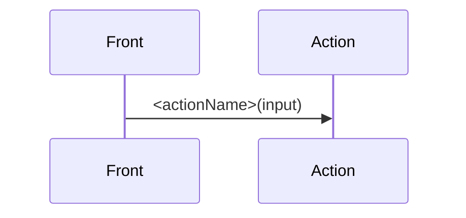

# <actionName> — <Título>

| Campo           | Valor                                                |
| --------------- | ---------------------------------------------------- |
| Action          | `src/actions/<modulo>/<actionName>.action.ts`        |
| Schema          | `src/core/schemas/<modulo>/<actionName>.schema.ts`   |
| Servicio        | `src/core/services/<modulo>/<actionName>.service.ts` |
| Permiso         |                                                      |
| Equivalente API | `<MÉTODO> /api/... → <status>`                       |

## Uso desde el front

| Import               | Ruta                                          | Para qué                                                                                     |
| -------------------- | --------------------------------------------- | -------------------------------------------------------------------------------------------- |
| `<actionName>Action` | `src/actions/<modulo>/<actionName>.action.ts` |                                                                                              |
| `ActionResult<T>`    | `src/core/types/action-result.ts`             | Tipa la respuesta; se discrimina por `ok` para leer `data` o `error` (`code`, `fieldErrors`) |
| `<Tipo>`             | `src/core/types/<modulo>/<tipo>.types.ts`     | Tipo de `data` en el caso de éxito                                                           |

**Por qué solo esto:** el front consume la Action y los tipos de su resultado. El schema Zod y el
Servicio son del back y no se importan en componentes cliente.

```tsx
const result = await < actionName > Action(input)

if (!result.ok) {
  // result.error.code, result.error.message, result.error.fieldErrors?
  return
}

// result.data: <Tipo>
```

## Input

| Campo | Tipo | Reglas | Requerido |
| ----- | ---- | ------ | --------- |
|       |      |        |           |

```json
{}
```

## Éxito

`ActionResult<T>`

```json
{ "ok": true, "data": {}, "message": "" }
```

## Errores

| code | Cuándo | message | HTTP (API) |
| ---- | ------ | ------- | ---------- |
|      |        |         |            |

```json
{ "ok": false, "error": { "code": "", "message": "" } }
```

## Efectos secundarios

-

## Flujo


