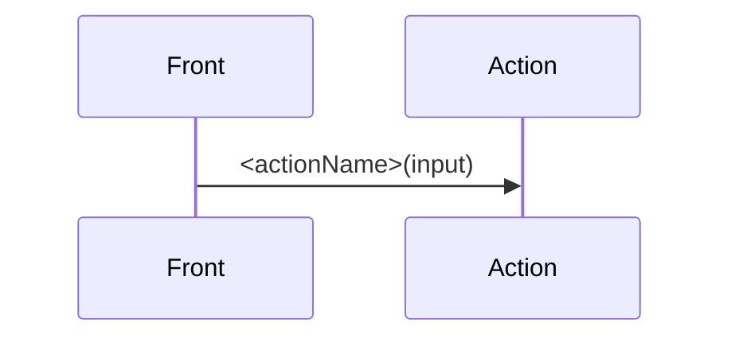

# <actionName> — <Título>

| Campo | Valor |
|---|---|
| Action | `src/actions/<modulo>/<actionName>.action.ts` |
| Schema | `src/core/schemas/<modulo>/<actionName>.schema.ts` |
| Servicio | `src/core/services/<modulo>/<actionName>.service.ts` |
| Permiso | |
| Equivalente API | `<MÉTODO> /api/... → <status>` |

## Input

| Campo | Tipo | Reglas | Requerido |
|---|---|---|---|
| | | | |

```json
{}
```

## Éxito

`ActionResult<T>`

```json
{ "ok": true, "data": {}, "message": "" }
```

## Errores

| code | Cuándo | message | HTTP (API) |
|---|---|---|---|
| | | | |

```json
{ "ok": false, "error": { "code": "", "message": "" } }
```

## Efectos secundarios

-

## Flujo


