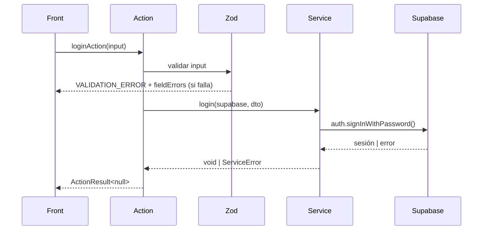

# login — Iniciar sesión

| Campo           | Valor                                           |
| --------------- | ----------------------------------------------- |
| Action          | `src/actions/auth/login.action.ts`              |
| Schema          | `src/core/schemas/auth/login.schema.ts`         |
| Servicio        | `src/core/services/auth/login.service.ts`       |
| Permiso         | Público; solo permite iniciar una sesión válida |
| Equivalente API | No aplica                                       |

La función exportada actualmente es `loginAction`.

## Input

| Campo      | Tipo     | Reglas                                | Requerido |
| ---------- | -------- | ------------------------------------- | --------- |
| `email`    | `string` | Se recorta (`trim`) y debe ser válido | Sí        |
| `password` | `string` | No puede estar vacío                  | Sí        |

```json
{
  "email": "admin@restodev.com",
  "password": "contraseña-secreta"
}
```

## Éxito

`ActionResult<null>`

```json
{
  "ok": true,
  "data": null,
  "message": "Sesión iniciada"
}
```

## Errores

| code               | Cuándo                                          | message                            | HTTP (API) |
| ------------------ | ----------------------------------------------- | ---------------------------------- | ---------- |
| `VALIDATION_ERROR` | Falla el schema Zod                             | Datos inválidos                    | 400        |
| `UNAUTHORIZED`     | Supabase rechaza las credenciales               | Email o contraseña incorrectos     | 401        |
| `INTERNAL_ERROR`   | Falla inesperada de autenticación o del sistema | Error inesperado. Intentá de nuevo | 500        |

```json
{
  "ok": false,
  "error": {
    "code": "UNAUTHORIZED",
    "message": "Email o contraseña incorrectos"
  }
}
```

## Validación por capa

- **Zod en la Action:** valida que el email sea un string recortado con formato válido y que la contraseña no esté vacía.
- **Servicio:** ejecuta `auth.signInWithPassword`; traduce credenciales inválidas a `UNAUTHORIZED` y otras fallas de Supabase a `INTERNAL_ERROR`.
- **Base de datos:** no realiza consultas de negocio.

## Efectos secundarios

- Se crean o actualizan las cookies de sesión de Supabase.
- El cliente navega a `/admin` y hace `router.refresh()`.

## Flujo



## Estado de implementación

- **Implementado:** Server Action, validación Zod, Servicio y formulario conectado.
