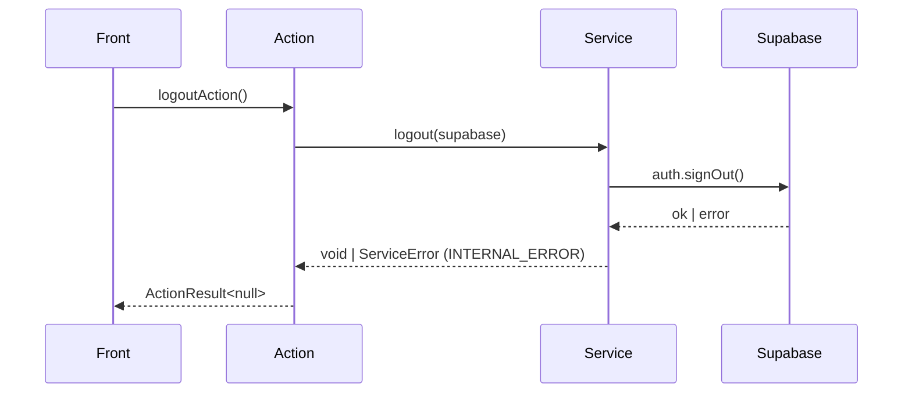

# logout — Cerrar sesión

| Campo           | Valor                                             |
| --------------- | ------------------------------------------------- |
| Action          | `src/actions/auth/logout.action.ts`               |
| Servicio        | `src/core/services/auth/logout.service.ts`        |
| Permiso         | Ninguno (si no hay sesión, también responde `ok`) |
| Equivalente API | No aplica                                         |

## Input

Sin campos.

## Éxito

`ActionResult<null>`

```json
{
  "ok": true,
  "data": null,
  "message": "Sesión cerrada"
}
```

## Errores

| code             | Cuándo                 | message                            | HTTP (API) |
| ---------------- | ---------------------- | ---------------------------------- | ---------- |
| `INTERNAL_ERROR` | Falla `auth.signOut()` | Error inesperado. Intentá de nuevo | 500        |

```json
{
  "ok": false,
  "error": {
    "code": "INTERNAL_ERROR",
    "message": "Error inesperado. Intentá de nuevo"
  }
}
```

## Efectos secundarios

- Se eliminan las cookies de sesión de Supabase.
- El cliente navega a `/` y hace `router.refresh()`.

## Flujo


