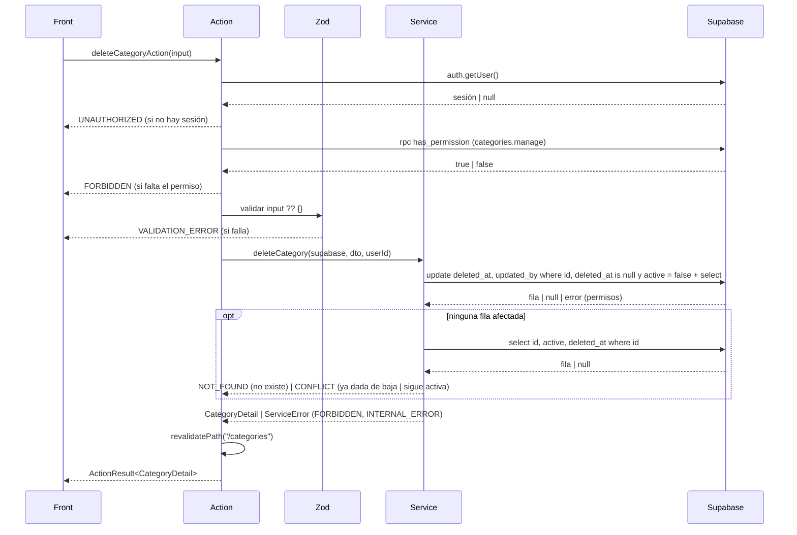

# deleteCategory — Dar de baja una categoría

| Campo           | Valor                                                                                   |
| --------------- | --------------------------------------------------------------------------------------- |
| Action          | `src/actions/categories/deleteCategory.action.ts` (exporta `deleteCategoryAction`)      |
| Schema          | `src/core/schemas/categories/deleteCategory.schema.ts`                                  |
| Servicio        | `src/core/services/categories/deleteCategory.service.ts`                                |
| Permiso         | Sesión activa y permiso `categories.manage`                                             |
| Equivalente API | A definir (Route Handler aún no implementado; por ejemplo `DELETE /api/categories/:id`) |

La función exportada es `deleteCategoryAction`. Los códigos HTTP de esta ficha describen un Route
Handler futuro; la Server Action no devuelve códigos HTTP.

Es una **baja lógica**: la fila no se borra, se completa `deleted_at`. La tabla `categories` no
tiene `GRANT` de `DELETE`, así que un borrado físico es imposible incluso desde la Data API.

**Precondición:** solo se puede dar de baja una categoría **inactiva** (`active = false`). Para dar
de baja una categoría activa, primero hay que desactivarla con `updateCategory` (`active: false`).
Así una categoría activa nunca queda dada de baja ni sigue apareciendo como activa.

## Uso desde el front

| Import                 | Ruta                                              | Para qué                                                                                     |
| ---------------------- | ------------------------------------------------- | -------------------------------------------------------------------------------------------- |
| `deleteCategoryAction` | `src/actions/categories/deleteCategory.action.ts` | Se llama desde el botón "Dar de baja" con el `id` de la categoría                            |
| `ActionResult<T>`      | `src/core/types/action-result.ts`                 | Tipa la respuesta; se discrimina por `ok` para leer `data` o `error` (`code`, `fieldErrors`) |
| `CategoryDetail`       | `src/core/types/categories/category.types.ts`     | Tipo de `data` en el caso de éxito (`ActionResult<CategoryDetail>`)                          |
| `DeleteCategoryInput`  | `src/core/types/categories/category.types.ts`     | Tipo del input (`{ id }`)                                                                    |

**Por qué `CategoryDetail`:** la operación devuelve la categoría tal como quedó, con la misma forma
que `getCategory` y `updateCategory`. El front puede reemplazar el elemento en su estado y ver que
`deleted_at` ya tiene fecha, sin volver a consultar.

**Qué hacer en el front:** mostrar "Dar de baja" solo para categorías inactivas (o, si está activa,
ofrecer primero desactivarla). Aun así, el front no es la barrera: la Action rechaza con `CONFLICT`
una categoría activa. Tras una baja, la categoría deja de aparecer en el listado y en
`getCategoryAction` salvo con `include_deleted`; el front debe quitarla de la lista o refrescarla.
La Action ya revalida `/categories`.

```tsx
const result = await deleteCategoryAction({ id })

if (!result.ok) {
  // result.error.code, result.error.message, result.error.fieldErrors?
  // NOT_FOUND: no existe una categoría con ese id
  // CONFLICT: sigue activa, ya estaba dada de baja (o, cuando exista `products`, tiene productos activos)
  return
}

// result.data: CategoryDetail (con deleted_at completo y active: false)
```

## Input

| Campo | Tipo     | Reglas      | Requerido |
| ----- | -------- | ----------- | --------- |
| `id`  | `string` | UUID válido | Sí        |

Campos que **no** se reciben: `deleted_at` (lo fija el Servicio con la fecha actual), `updated_by`
(se toma de la sesión) y cualquier campo de datos de la categoría: la baja no modifica `name`,
`slug`, `icon_name`, `display_order` ni `active`.

```json
{
  "id": "3f6a9c1e-2b47-4d8a-9e15-7a0c4b2d6f88"
}
```

## Éxito

`ActionResult<CategoryDetail>`

- Devuelve la categoría con `deleted_at` completo (fecha y hora de la baja, en ISO 8601) y `active: false`.
- No incluye campos de auditoría (`created_at`, `updated_at`, `updated_by`).

```json
{
  "ok": true,
  "data": {
    "id": "3f6a9c1e-2b47-4d8a-9e15-7a0c4b2d6f88",
    "name": "Bebidas",
    "slug": "bebidas",
    "icon_name": "cup-soda",
    "display_order": 1,
    "active": false,
    "deleted_at": "2026-11-20T13:45:12.381+00:00"
  },
  "message": "Categoría dada de baja"
}
```

## Errores

| code               | Cuándo                                                                                                                     | message                                       | HTTP (API) |
| ------------------ | -------------------------------------------------------------------------------------------------------------------------- | --------------------------------------------- | ---------- |
| `VALIDATION_ERROR` | Falla el schema (`id` ausente o no es un UUID)                                                                             | Datos inválidos                               | 400        |
| `UNAUTHORIZED`     | Sin sesión                                                                                                                 | Sesión requerida                              | 401        |
| `FORBIDDEN`        | El usuario no tiene `categories.manage` (lo comprueba la Action) o la BD rechaza la escritura por RLS o permisos (`42501`) | No tenés permiso para dar de baja categorías  | 403        |
| `NOT_FOUND`        | No existe una categoría con ese `id` (o RLS la oculta)                                                                     | Categoría no encontrada                       | 404        |
| `CONFLICT`         | La categoría **ya está dada de baja**                                                                                      | La categoría ya está dada de baja             | 409        |
| `CONFLICT`         | La categoría **sigue activa** (`active = true`)                                                                            | Desactivá la categoría antes de darla de baja | 409        |
| `CONFLICT`         | _Pendiente (requiere `products`):_ la categoría tiene productos activos                                                    | A definir (indica el motivo)                  | 409        |
| `INTERNAL_ERROR`   | Falla inesperada                                                                                                           | Error inesperado. Intentá de nuevo            | 500        |

```json
{
  "ok": false,
  "error": {
    "code": "CONFLICT",
    "message": "Desactivá la categoría antes de darla de baja"
  }
}
```

```json
{
  "ok": false,
  "error": {
    "code": "VALIDATION_ERROR",
    "message": "Datos inválidos",
    "fieldErrors": {
      "id": ["El id debe ser un UUID válido"]
    }
  }
}
```

## Reglas de negocio aplicadas

- **Solo baja lógica.** Se completa `deleted_at` con la fecha y hora actuales y `updated_by` con el usuario de la sesión. `updated_at` lo actualiza el trigger `categories_set_updated_at`. No se ejecuta nunca un `DELETE`.
- **La categoría debe estar inactiva.** Solo se da de baja una categoría con `active = false`. Una categoría activa se rechaza con `CONFLICT` ("Desactivá la categoría antes de darla de baja"); hay que desactivarla antes con `updateCategory`. La baja no cambia `active`.
- **Los productos asociados deben estar inactivos (criterio 9 de la HU).** Si la categoría tiene al menos un producto activo, la baja se rechaza con `CONFLICT`. La regla debe vivir en la base (trigger o función) para valer aunque la escritura no pase por la Action, incluida la carrera con la asignación de un producto. Como `products` todavía no existe, **hoy esta regla no está aplicada**.
- **La baja es atómica.** El Servicio hace un único `UPDATE ... WHERE id = :id AND deleted_at IS NULL AND active = false`. No consulta antes: si dos solicitudes simultáneas intentan dar de baja la misma categoría, solo una encuentra la fila y la otra no afecta ninguna fila.
- **Cómo se distinguen los rechazos.** Si el `UPDATE` no afecta filas, el Servicio consulta por `id` sin filtros: si no existe es `NOT_FOUND`; si ya tiene `deleted_at` es `CONFLICT` "ya está dada de baja" (se revisa primero); si no, sigue activa y es `CONFLICT` "Desactivá la categoría...". En ningún caso se modifica nada.
- **Carrera con la activación.** Si alguien reactiva la categoría justo antes de la baja, el `UPDATE` no la encuentra inactiva y se rechaza: no hay forma de que quede dada de baja y activa.
- **La baja no libera `name` ni `slug`.** Siguen ocupados (la unicidad incluye las categorías dadas de baja). Para liberarlos hay que renombrar la categoría con `updateCategory`.
- **Efecto sobre las lecturas.** Una categoría dada de baja deja de aparecer por defecto en `listCategories` y en `getCategory`; solo se ve con `include_deleted = true`.
- **Restaurar no existe todavía.** Hasta que haya una HU de restauración, una categoría dada de baja solo se puede renombrar; no hay forma de volver a dejarla vigente desde la app. (Como además queda inactiva, tampoco se podría ofrecer productos desde ella.)
- **Permiso:** la Action comprueba la sesión y, antes de validar con Zod, `categories.manage` con `requirePermission` (`FORBIDDEN` si falta). RLS lo refuerza (`categories_update_by_permission`: la baja es un `UPDATE`; `GRANT` de `UPDATE` para `authenticated`).
- Si falta el `GRANT` o RLS rechaza la escritura, la base responde `42501` y el resultado es `FORBIDDEN`. Como la Action comprueba el permiso antes, un usuario sin `categories.manage` recibe `FORBIDDEN` y no el `NOT_FOUND` o el `CONFLICT` engañoso que produciría RLS al ocultar o bloquear la fila (el `UPDATE` no afectaría filas y la consulta de existencia podría no verla).
- **Pendiente de decidir:** la regla "categoría inactiva" hoy la aplica el Servicio, no la base. Una escritura directa por la Data API podría poner `deleted_at` en una categoría activa. Si hay que blindarlo, agregar un `CHECK (deleted_at is null or active = false)` (o trigger) en una migración; ojo, obligaría a que `updateCategory` no pueda reactivar una categoría dada de baja.

## Validación por capa

- **Action (antes de Zod):** sesión (`UNAUTHORIZED`) y permiso `categories.manage` (`FORBIDDEN`) con `requirePermission`.
- **Zod en la Action:** `id` presente y con formato UUID.
- **Servicio:** `UPDATE` atómico con `deleted_at IS NULL` y `active = false`, `deleted_at` y `updated_by`, distinción entre `NOT_FOUND` y los dos `CONFLICT`, traducción de `42501`.
- **Base de datos:** sin `GRANT` de `DELETE`, la baja física es imposible. No requiere migración nueva por ahora; la regla de productos llegará junto con `products`.

## Efectos secundarios

- Tras la baja, se llama a `revalidatePath("/categories")`.
- Pendiente: registrar la baja en `audit_logs` cuando exista el mecanismo de auditoría.

## Flujo



## Estado de implementación

- **Implementado:** Action (con verificación de permiso), schema Zod, Servicio y tipos (`DeleteCategoryInput`, `DeleteCategoryDto`), incluida la precondición de categoría inactiva.
- **Pendiente:** regla de productos activos en la base (junto con `products`), Route Handler, auditoría y, opcionalmente, el `CHECK` en la base para la regla de inactividad.
- **A confirmar (HU-CAT-005):** `CONFLICT` si ya está dada de baja y que se devuelva la categoría con `deleted_at`.
