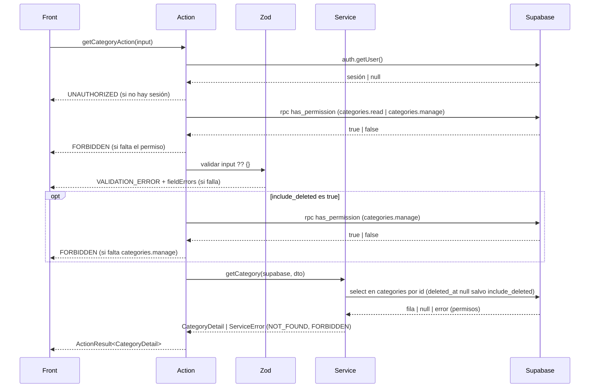

# getCategory — Obtener categoría

| Campo           | Valor                                                                                                             |
| --------------- | ----------------------------------------------------------------------------------------------------------------- |
| Action          | `src/actions/categories/getCategory.action.ts` (exporta `getCategoryAction`)                                      |
| Schema          | `src/core/schemas/categories/getCategory.schema.ts`                                                               |
| Servicio        | `src/core/services/categories/getCategory.service.ts`                                                             |
| Permiso         | Sesión activa y permiso `categories.read` o `categories.manage`; con `include_deleted: true`, `categories.manage` |
| Equivalente API | Planificado: `GET /api/categories/:id → 200` (Route Handler aún no implementado)                                  |

La función exportada es `getCategoryAction`. Los códigos HTTP de esta ficha describen el Route
Handler planificado; la Server Action no devuelve códigos HTTP.

## Uso desde el front

| Import              | Ruta                                           | Para qué                                                                                     |
| ------------------- | ---------------------------------------------- | -------------------------------------------------------------------------------------------- |
| `getCategoryAction` | `src/actions/categories/getCategory.action.ts` | Se llama desde la vista de detalle o de edición con el `id` de la categoría                  |
| `ActionResult<T>`   | `src/core/types/action-result.ts`              | Tipa la respuesta; se discrimina por `ok` para leer `data` o `error` (`code`, `fieldErrors`) |
| `CategoryDetail`    | `src/core/types/categories/category.types.ts`  | Tipo de `data` en el caso de éxito (`ActionResult<CategoryDetail>`)                          |
| `GetCategoryInput`  | `src/core/types/categories/category.types.ts`  | Tipo del input (`id`, `include_deleted`)                                                     |

**Por qué `CategoryDetail` y no `Category`:** igual que el listado, la Action devuelve solo los
campos que necesita la vista, no la fila completa. Los campos de auditoría (`created_at`,
`updated_at`, `updated_by`) no los usa ninguna pantalla y `updated_by` expone un id de usuario sin
necesidad. Hoy `CategoryDetail` tiene los mismos campos que `CategoryListItem`, pero es un tipo
propio para poder ampliar el detalle sin afectar al listado. El schema Zod y el Servicio no se
importan en el cliente: son del back.

**Por qué `include_deleted` es un parámetro:** igual que en `listCategories`, el Servicio decide si
una categoría dada de baja es visible. Por defecto se comporta como si no existiera
(`NOT_FOUND`); la pantalla que necesite verla (por ejemplo, para restaurarla) la pide
explícitamente. Así el permiso (`categories.manage`) se exige en un único lugar.

```tsx
const result = await getCategoryAction({ id, include_deleted })

if (!result.ok) {
  // result.error.code, result.error.message, result.error.fieldErrors?
  // NOT_FOUND: la categoría no existe (o está dada de baja y no se pidió include_deleted)
  return
}

// result.data: CategoryDetail
```

## Input

| Campo             | Tipo      | Reglas                                                                                                                                          | Requerido |
| ----------------- | --------- | ----------------------------------------------------------------------------------------------------------------------------------------------- | --------- |
| `id`              | `string`  | UUID válido                                                                                                                                     | Sí        |
| `include_deleted` | `boolean` | Default `false`. Si es `true`, también encuentra la categoría si está dada de baja (`deleted_at` distinto de `null`). Exige `categories.manage` | No        |

```json
{
  "id": "3f6a9c1e-2b47-4d8a-9e15-7a0c4b2d6f88",
  "include_deleted": false
}
```

## Éxito

`ActionResult<CategoryDetail>`

- Nunca devuelve la fila completa de `categories`: no incluye `created_at`, `updated_at` ni `updated_by`.
- Con `include_deleted` omitido o `false`, `deleted_at` es siempre `null`. Con `true`, una categoría dada de baja trae su fecha de baja.

```json
{
  "ok": true,
  "data": {
    "id": "3f6a9c1e-2b47-4d8a-9e15-7a0c4b2d6f88",
    "name": "Bebidas sin alcohol",
    "slug": "bebidas-sin-alcohol",
    "icon_name": "cup-soda",
    "display_order": 2,
    "active": true,
    "deleted_at": null
  },
  "message": "Categoría obtenida"
}
```

## Errores

| code               | Cuándo                                                                                                                                           | message                              | HTTP (API) |
| ------------------ | ------------------------------------------------------------------------------------------------------------------------------------------------ | ------------------------------------ | ---------- |
| `VALIDATION_ERROR` | Falla el schema (`id` ausente o no es un UUID, `include_deleted` no booleano)                                                                    | Datos inválidos                      | 400        |
| `UNAUTHORIZED`     | Sin sesión                                                                                                                                       | Sesión requerida                     | 401        |
| `FORBIDDEN`        | No tiene `categories.read` ni `categories.manage`, o pide `include_deleted` sin `categories.manage`, o RLS o GRANT rechazan la lectura (`42501`) | No tenés permiso para ver categorías | 403        |
| `NOT_FOUND`        | No existe una categoría con ese `id`, o está dada de baja y `include_deleted` no es `true`                                                       | Categoría no encontrada              | 404        |
| `INTERNAL_ERROR`   | Falla inesperada                                                                                                                                 | Error inesperado. Intentá de nuevo   | 500        |

```json
{
  "ok": false,
  "error": {
    "code": "NOT_FOUND",
    "message": "Categoría no encontrada"
  }
}
```

```json
{
  "ok": false,
  "error": {
    "code": "VALIDATION_ERROR",
    "message": "Datos inválidos",
    "fieldErrors": {
      "id": ["El id debe ser un UUID válido"]
    }
  }
}
```

No usa `CONFLICT`: leer no depende de unicidad.

## Reglas de negocio aplicadas

- Una categoría dada de baja (`deleted_at` distinto de `null`) no se encuentra salvo que se pida `include_deleted: true`; se responde `NOT_FOUND`, igual que si el `id` no existiera.
- El `id` se valida como UUID en la Action para evitar enviar a la base un valor que provocaría un error de sintaxis (`22P02`) y para responder con un error entendible.
- Si RLS oculta la fila, la consulta no devuelve filas y el resultado es `NOT_FOUND`; si el `GRANT` falta, es `FORBIDDEN` (`42501`).
- El Servicio selecciona solo las columnas de `CategoryDetail`; no lee los campos de auditoría.
- **Permiso:** la Action exige `categories.read` o `categories.manage` antes de validar y, si `include_deleted` es `true`, `categories.manage` (se comprueba tras validar, porque depende del input). RLS lo refuerza (`categories_select_by_permission`): `categories.read` solo ve las vigentes y `categories.manage` ve todas.

## Efectos secundarios

Ninguno (lectura pura).

## Flujo



## Estado de implementación

- **Implementado:** Action (con verificación de permiso), schema Zod, Servicio y tipos (`CategoryDetail`, `GetCategoryInput`, `GetCategoryDto`).
- **Pendiente:** el Route Handler `GET /api/categories/:id`.
