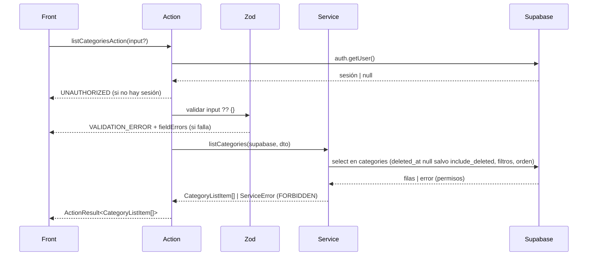

# listCategories — Listar categorías

| Campo           | Valor                                                                                                                                                              |
| --------------- | ------------------------------------------------------------------------------------------------------------------------------------------------------------------ |
| Action          | `src/actions/categories/listCategories.action.ts` (exporta `listCategoriesAction`)                                                                                 |
| Schema          | `src/core/schemas/categories/listCategories.schema.ts`                                                                                                             |
| Servicio        | `src/core/services/categories/listCategories.service.ts`                                                                                                           |
| Permiso         | Sesión activa (provisorio: la política RLS actual permite leer a cualquier usuario autenticado). Pendiente: exigir rol `admin` cuando `include_deleted` sea `true` |
| Equivalente API | Implementado: `GET /api/categories → 200`                                                                                                                          |

## Uso desde el front

| Import                 | Ruta                                              | Para qué                                                                                     |
| ---------------------- | ------------------------------------------------- | -------------------------------------------------------------------------------------------- |
| `listCategoriesAction` | `src/actions/categories/listCategories.action.ts` | Se llama desde la vista o el hook de consulta, con o sin filtros                             |
| `ActionResult<T>`      | `src/core/types/action-result.ts`                 | Tipa la respuesta; se discrimina por `ok` para leer `data` o `error` (`code`, `fieldErrors`) |
| `CategoryListItem`     | `src/core/types/categories/category.types.ts`     | Tipo de cada elemento de `data` (`ActionResult<CategoryListItem[]>`)                         |
| `ListCategoriesInput`  | `src/core/types/categories/category.types.ts`     | Tipo del input (`search`, `active`, `include_deleted`), útil para tipar filtros del front    |

**Por qué `CategoryListItem` y no `Category`:** el listado devuelve solo los campos que necesita la
vista, no la fila completa. Si el front tipa la lista con `Category`, TypeScript esperaría campos
(`created_at`, `updated_at`, `updated_by`) que la Action no envía. El schema Zod y el Servicio no se
importan en el cliente: son del back.

**Por qué `include_deleted` es un parámetro y no un filtro del front:** el filtrado de las categorías
dadas de baja lo hace el Servicio. Por defecto no salen; la pantalla que necesita verlas (por ejemplo,
para restaurar una categoría) las pide explícitamente. Así una vista normal nunca las muestra por
olvido, y cuando exista el rol `admin` el permiso se exige en un único lugar.

```tsx
const result = await listCategoriesAction({ search, active, include_deleted })

if (!result.ok) {
  // result.error.code, result.error.message, result.error.fieldErrors?
  return
}

// result.data: CategoryListItem[]  ([] si no hay resultados, no es un error)
// Con include_deleted: true, las dadas de baja traen deleted_at con fecha
```

## Input

Todo el input es opcional: `listCategoriesAction()` sin argumentos lista todas las categorías vigentes (no dadas de baja).

| Campo             | Tipo      | Reglas                                                                                                                                                           | Requerido |
| ----------------- | --------- | ---------------------------------------------------------------------------------------------------------------------------------------------------------------- | --------- |
| `search`          | `string`  | Se recorta (`trim`); máximo 80 caracteres. Vacío = sin filtro. Busca coincidencias parciales en `name`, sin distinguir mayúsculas/minúsculas (no ignora acentos) | No        |
| `active`          | `boolean` | Si se envía, filtra por `active`. Si se omite, devuelve activas e inactivas                                                                                      | No        |
| `include_deleted` | `boolean` | Default `false`. Si es `true`, incluye también las categorías dadas de baja (`deleted_at` distinto de `null`). Pendiente: exigir rol `admin`                     | No        |

Sin paginación por ahora: un menú tiene pocas categorías. Si hiciera falta, se agrega `page` y `page_size` y `data` pasa a `{ items, total, page, page_size }` (cambio de contrato).

```json
{
  "search": "beb",
  "active": true,
  "include_deleted": false
}
```

## Éxito

`ActionResult<CategoryListItem[]>`

- Nunca devuelve la fila completa de `categories`.
- Orden fijo: `display_order` ascendente y, a igual orden, `name` ascendente.
- Sin resultados no es un error: `data` es `[]`.
- Con `include_deleted` omitido o `false`, `deleted_at` es siempre `null`. Con `true`, las categorías dadas de baja traen su fecha de baja.

```json
{
  "ok": true,
  "data": [
    {
      "id": "3f6a9c1e-2b47-4d8a-9e15-7a0c4b2d6f88",
      "name": "Bebidas sin alcohol",
      "slug": "bebidas-sin-alcohol",
      "icon_name": "cup-soda",
      "display_order": 2,
      "active": true,
      "deleted_at": null
    }
  ],
  "message": "Categorías obtenidas"
}
```

## Errores

| code               | Cuándo                                                                                                        | message                              | HTTP (API) |
| ------------------ | ------------------------------------------------------------------------------------------------------------- | ------------------------------------ | ---------- |
| `VALIDATION_ERROR` | Falla el schema (`search` demasiado largo, `active` o `include_deleted` no booleanos)                         | Datos inválidos                      | 400        |
| `UNAUTHORIZED`     | Sin sesión                                                                                                    | Sesión requerida                     | 401        |
| `FORBIDDEN`        | RLS o GRANT rechazan la lectura (`42501`). Al implementar roles, también si `include_deleted` y no es `admin` | No tenés permiso para ver categorías | 403        |
| `INTERNAL_ERROR`   | Falla inesperada                                                                                              | Error inesperado. Intentá de nuevo   | 500        |

```json
{
  "ok": false,
  "error": {
    "code": "VALIDATION_ERROR",
    "message": "Datos inválidos",
    "fieldErrors": {
      "search": ["La búsqueda no puede superar los 80 caracteres"]
    }
  }
}
```

No usa `NOT_FOUND` ni `CONFLICT`: listar nunca falla por ausencia de datos ni por unicidad.

## Reglas de negocio aplicadas

- El `%` y el `_` de `search` se tratan como texto literal, no como comodines.
- Por defecto el listado excluye las categorías dadas de baja (`deleted_at is null`). Se incluyen solo con `include_deleted: true`.
- `name` y `slug` son únicos incluso entre las dadas de baja, por eso la vista de administración necesita poder listarlas para restaurarlas en vez de crear un duplicado.

## Efectos secundarios

Ninguno (lectura pura).

## Flujo



## Estado de implementación

- **Implementado:** Action, schema Zod (incluye `include_deleted`) y Servicio con filtro de baja lógica.
- **Pendiente:** exigir rol `admin` para `include_deleted`.
