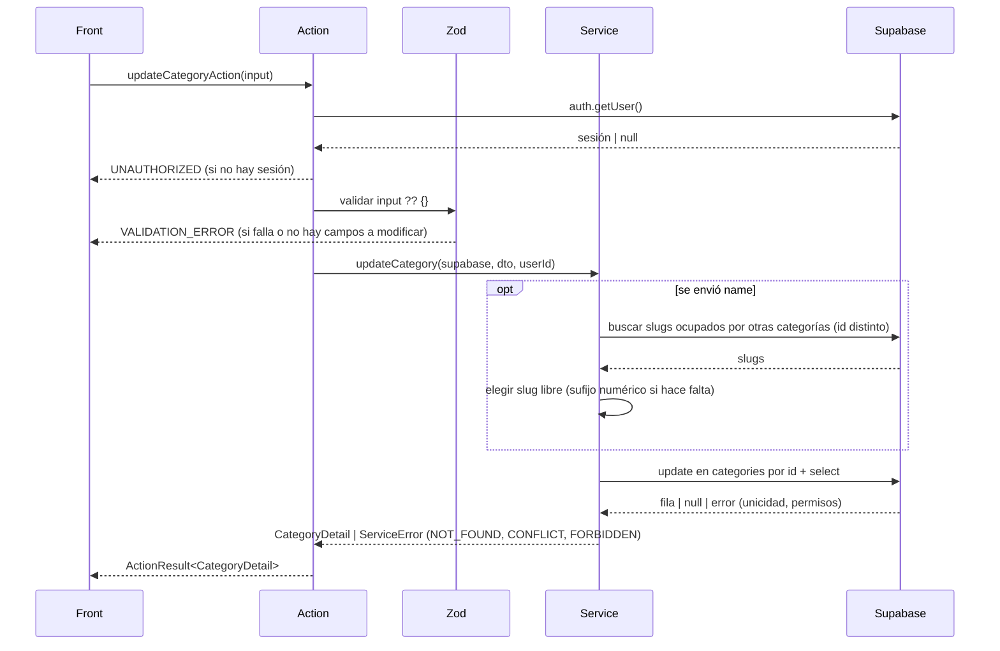

# updateCategory — Modificar categoría

| Campo           | Valor                                                                              |
| --------------- | ---------------------------------------------------------------------------------- |
| Action          | `src/actions/categories/updateCategory.action.ts` (exporta `updateCategoryAction`) |
| Schema          | `src/core/schemas/categories/updateCategory.schema.ts`                             |
| Servicio        | `src/core/services/categories/updateCategory.service.ts`                           |
| Permiso         | Actual: cualquier usuario con sesión. Pendiente: exigir rol `admin`                |
| Equivalente API | Planificado: `PATCH /api/categories/:id → 200` (Route Handler aún no implementado) |

La función exportada es `updateCategoryAction`. Los códigos HTTP de esta ficha describen el Route
Handler planificado; la Server Action no devuelve códigos HTTP.

## Uso desde el front

| Import                 | Ruta                                              | Para qué                                                                                     |
| ---------------------- | ------------------------------------------------- | -------------------------------------------------------------------------------------------- |
| `updateCategoryAction` | `src/actions/categories/updateCategory.action.ts` | Se llama desde el formulario de edición con el `id` y los campos que cambiaron               |
| `ActionResult<T>`      | `src/core/types/action-result.ts`                 | Tipa la respuesta; se discrimina por `ok` para leer `data` o `error` (`code`, `fieldErrors`) |
| `CategoryDetail`       | `src/core/types/categories/category.types.ts`     | Tipo de `data` en el caso de éxito (`ActionResult<CategoryDetail>`)                          |
| `UpdateCategoryInput`  | `src/core/types/categories/category.types.ts`     | Tipo del input (`id` y los campos a modificar)                                               |

**Por qué `CategoryDetail` y no `Category`:** igual que `getCategory`, la Action devuelve solo los
campos que usa la vista. Así el formulario de edición recibe la misma forma que obtuvo al cargar la
categoría y puede reemplazar su estado con el resultado (incluido el `slug` nuevo). Los campos de
auditoría no se exponen.

**Por qué es una actualización parcial:** el formulario envía solo lo que cambió. Un campo omitido
no se modifica. Para quitar el ícono se envía `icon_name: null`; omitirlo lo deja como está. Como
enviar `name` regenera el `slug`, el front debe mandar `name` únicamente si el usuario lo cambió.

**Por qué también se modifican las categorías dadas de baja:** una categoría dada de baja sigue
ocupando su `name` y su `slug`. Si no se pudiera renombrar, esos valores quedarían bloqueados para
siempre. Por eso esta operación no distingue entre vigentes y dadas de baja.

```tsx
const result = await updateCategoryAction({ id, name, display_order })

if (!result.ok) {
  // result.error.code, result.error.message, result.error.fieldErrors?
  // NOT_FOUND: no existe una categoría con ese id
  // CONFLICT: ya existe otra categoría con ese nombre
  return
}

// result.data: CategoryDetail
```

## Input

| Campo           | Tipo             | Reglas                                                                                                                                                                      | Requerido |
| --------------- | ---------------- | --------------------------------------------------------------------------------------------------------------------------------------------------------------------------- | --------- |
| `id`            | `string`         | UUID válido                                                                                                                                                                 | Sí        |
| `name`          | `string`         | Se recorta (`trim`); 2–80 caracteres; no puede usarlo **otra** categoría (vigente o dada de baja), sin distinguir mayúsculas/minúsculas. Si se envía, el `slug` se regenera | No        |
| `icon_name`     | `string \| null` | 1–50 caracteres si se envía; `null` quita el ícono                                                                                                                          | No        |
| `display_order` | `number`         | Entero, `>= 0`                                                                                                                                                              | No        |
| `active`        | `boolean`        |                                                                                                                                                                             | No        |

**Regla del conjunto:** además de `id`, hay que enviar al menos un campo a modificar. Un input
con solo `id` es `VALIDATION_ERROR`.

Campos que **no** se reciben: `slug` (se regenera a partir de `name`; el cliente nunca lo envía),
`deleted_at` (la baja y la restauración son otra operación), `updated_by` (se toma de la sesión) y
`created_at` / `updated_at` (los maneja la base).

```json
{
  "id": "3f6a9c1e-2b47-4d8a-9e15-7a0c4b2d6f88",
  "name": "Bebidas",
  "display_order": 1
}
```

## Éxito

`ActionResult<CategoryDetail>`

- Devuelve la categoría ya modificada, con los mismos campos que `getCategory`.
- `deleted_at` conserva su valor: es `null` en una categoría vigente y trae la fecha de baja si se modificó una dada de baja. Esta operación nunca lo cambia.
- Si se envió `name`, `slug` refleja el valor regenerado.

```json
{
  "ok": true,
  "data": {
    "id": "3f6a9c1e-2b47-4d8a-9e15-7a0c4b2d6f88",
    "name": "Bebidas",
    "slug": "bebidas",
    "icon_name": "cup-soda",
    "display_order": 1,
    "active": true,
    "deleted_at": null
  },
  "message": "Categoría actualizada"
}
```

## Errores

| code               | Cuándo                                                                                                                  | message                                    | HTTP (API) |
| ------------------ | ----------------------------------------------------------------------------------------------------------------------- | ------------------------------------------ | ---------- |
| `VALIDATION_ERROR` | Falla el schema (`id` inválido, nombre fuera de rango, `display_order` negativo o no entero) o no se envía ningún campo | Datos inválidos / Enviá al menos un campo  | 400        |
| `UNAUTHORIZED`     | Sin sesión                                                                                                              | Sesión requerida                           | 401        |
| `FORBIDDEN`        | La BD rechaza la lectura o escritura por RLS o permisos (`42501`). Al implementar roles, también si no es `admin`       | No tenés permiso para modificar categorías | 403        |
| `NOT_FOUND`        | No existe una categoría con ese `id`                                                                                    | Categoría no encontrada                    | 404        |
| `CONFLICT`         | El `name` ya lo usa **otra** categoría (incluso una dada de baja)                                                       | Ya existe una categoría con ese nombre     | 409        |
| `INTERNAL_ERROR`   | Falla inesperada, o no se logró fijar el `slug` tras reintentar                                                         | Error inesperado. Intentá de nuevo         | 500        |

Cuando falla la regla del conjunto, `fieldErrors` queda vacío y `message` trae el motivo
(`Enviá al menos un campo para modificar`). Una colisión de `slug` nunca produce `CONFLICT`: se
resuelve con sufijo numérico.

```json
{
  "ok": false,
  "error": {
    "code": "CONFLICT",
    "message": "Ya existe una categoría con ese nombre"
  }
}
```

```json
{
  "ok": false,
  "error": {
    "code": "VALIDATION_ERROR",
    "message": "Datos inválidos",
    "fieldErrors": {
      "name": ["El nombre debe tener al menos 2 caracteres"]
    }
  }
}
```

## Reglas de negocio aplicadas

- **Se pueden modificar todas las categorías**, vigentes o dadas de baja, para que una categoría dada de baja pueda liberar su `name` y su `slug`. Solo `NOT_FOUND` cuando el `id` no existe. `deleted_at` no es editable acá; restaurar una categoría es otra operación.
- **El `slug` se regenera cuando se envía `name`**, con la misma regla que `createCategory`: minúsculas, sin acentos, palabras separadas por guiones; si no quedan caracteres alfanuméricos, se usa `categoria`. Debe cumplir `^[a-z0-9]+(-[a-z0-9]+)*$`. Si no se envía `name`, el `slug` no cambia.
- **Una categoría no choca consigo misma.** Al comprobar si el `slug` generado está ocupado, el Servicio excluye la fila que se está modificando (`id <> :id`) y revisa todas las demás, incluidas las dadas de baja. Así, renombrar "Bebidas" a "bebidas" conserva el slug `bebidas`, y una categoría con slug `bebidas-2` que se renombra a un nombre que genera `bebidas-2` no recibe `bebidas-3`.
- Si el `slug` generado ya lo usa otra categoría, el Servicio agrega un sufijo numérico (`-2`, `-3`, ...). Nunca devuelve error por colisión de `slug`.
- **La unicidad de `name` también excluye a la propia categoría.** La base (`categories_name_key`, `citext`) no compara una fila contra sí misma al actualizarla, por lo que conservar el mismo `name` o cambiar solo las mayúsculas no genera conflicto. Un `name` que ya tiene otra categoría falla con `23505`, que el Servicio traduce a `CONFLICT`.
- Si la actualización falla por violación de unicidad del `slug` (otra petición lo ocupó entre la consulta y el `UPDATE`), el Servicio recalcula y reintenta hasta tres veces; si no lo logra, devuelve `INTERNAL_ERROR`.
- Si se envía `name`, el `slug` se regenera aunque el valor sea igual al actual. El front envía `name` solo si cambió.
- `updated_by` se completa con el `id` del usuario de la sesión y `updated_at` lo actualiza el trigger `categories_set_updated_at`.
- No se detecta "sin cambios": si los valores enviados son iguales a los actuales, la fila igual se actualiza y se refresca `updated_at`.
- Concurrencia: gana la última escritura. No hay control de versión optimista.
- La Action valida con Zod y la base replica las reglas con constraints `CHECK` (`categories_name_length`, `categories_icon_name_length`, `categories_slug_length`, `categories_slug_format`, `categories_display_order_check`), de modo que una escritura que no pase por la Action también queda protegida.
- RLS está habilitado y el `GRANT` incluye `UPDATE` para `authenticated`. **Actual:** la política provisoria permite acceso a cualquier usuario autenticado. **Pendiente:** exigir rol `admin` (`TODO(roles)` en la Action), considerando que modificar categorías dadas de baja podría requerirlo.
- Si RLS oculta la fila, el `UPDATE` no afecta filas y el resultado es `NOT_FOUND`; si falta el `GRANT`, es `FORBIDDEN` (`42501`).

## Validación por capa

- **Zod en la Action:** UUID del `id`, tipo/longitud/recorte de `name` e `icon_name`, entero no negativo para `display_order`, booleano para `active` y al menos un campo a modificar.
- **Servicio:** generación del `slug` y resolución de colisiones excluyendo la propia fila, `updated_by`, reintento ante carrera, traducción de `23505`, `42501` y fila no encontrada.
- **Base de datos:** unicidad de `name` y `slug`, formato y longitudes, `display_order >= 0`. No requiere migración nueva.

## Efectos secundarios

- Tras modificar la categoría, se llama a `revalidatePath("/categories")`.
- Pendiente: registrar el cambio en `audit_logs` cuando exista el mecanismo de auditoría.

## Flujo



## Estado de implementación

- **Implementado:** Action, schema Zod, Servicio y tipos (`UpdateCategoryInput`, `UpdateCategoryDto`).
- **Pendiente:** exigir rol `admin`, Route Handler `PATCH /api/categories/:id` y auditoría.
- **A confirmar:** qué hacer al desactivar (`active: false`) una categoría con productos activos cuando exista `products`.
