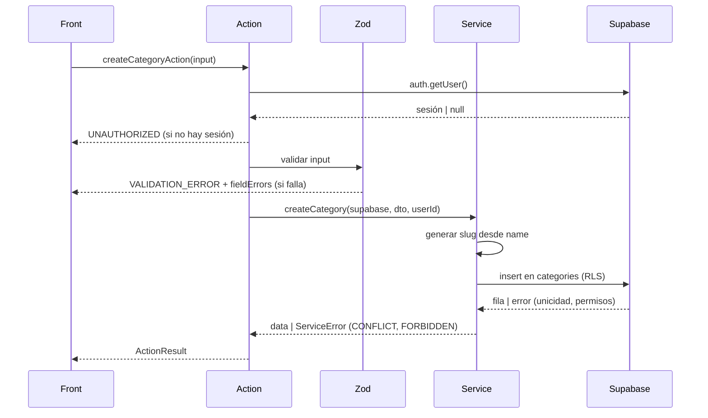

# createCategory — Crear categoría

| Campo           | Valor                                                                         |
| --------------- | ----------------------------------------------------------------------------- |
| Action          | `src/actions/categories/createCategory.action.ts`                             |
| Schema          | `src/core/schemas/categories/createCategory.schema.ts`                        |
| Servicio        | `src/core/services/categories/createCategory.service.ts`                      |
| Permiso         | Actual: cualquier usuario con sesión. Pendiente: exigir rol `admin`           |
| Equivalente API | Planificado: `POST /api/categories → 201` (Route Handler aún no implementado) |

La función exportada actualmente es `createCategoryAction`. El actor y los criterios funcionales
están en la [Historia de Usuario](../../historias_de_usuario/categories/crear_categoria.md).
Los códigos HTTP de esta ficha describen el Route Handler planificado; la Server Action no devuelve
códigos HTTP.

## Input

| Campo           | Tipo             | Reglas                                                                                                                                                   | Requerido |
| --------------- | ---------------- | -------------------------------------------------------------------------------------------------------------------------------------------------------- | --------- |
| `name`          | `string`         | Se recorta (`trim`); 2–80 caracteres; único en Servicio/BD entre todas las categorías, incluidas las dadas de baja, sin distinguir mayúsculas/minúsculas | Sí        |
| `icon_name`     | `string \| null` | 1–50 caracteres si se envía                                                                                                                              | No        |
| `display_order` | `number`         | Entero, `>= 0`. Default `0`                                                                                                                              | No        |
| `active`        | `boolean`        | Default `true`                                                                                                                                           | No        |

Campos que **no** se reciben: `slug` (se genera a partir de `name`), `deleted_at` (siempre `null` al crear), `updated_by` (se toma de la sesión) y `id`, `created_at`, `updated_at` (los asigna la base).

```json
{
  "name": "Bebidas sin alcohol",
  "icon_name": "cup-soda",
  "display_order": 2,
  "active": true
}
```

## Éxito

`ActionResult<Category>`

```json
{
  "ok": true,
  "data": {
    "id": "3f6a9c1e-2b47-4d8a-9e15-7a0c4b2d6f88",
    "name": "Bebidas sin alcohol",
    "slug": "bebidas-sin-alcohol",
    "icon_name": "cup-soda",
    "display_order": 2,
    "active": true,
    "deleted_at": null,
    "created_at": "2026-11-13T05:20:00Z",
    "updated_at": "2026-11-13T05:20:00Z",
    "updated_by": "7b1e4c52-9d3a-4f0e-8a21-5c6d7e8f9a01"
  },
  "message": "Categoría creada"
}
```

## Errores

| code               | Cuándo                                                                                                                       | message                                | HTTP (API) |
| ------------------ | ---------------------------------------------------------------------------------------------------------------------------- | -------------------------------------- | ---------- |
| `VALIDATION_ERROR` | Falla el schema (nombre vacío, `display_order` negativo, etc.)                                                               | Datos inválidos                        | 400        |
| `UNAUTHORIZED`     | Sin sesión                                                                                                                   | Sesión requerida                       | 401        |
| `FORBIDDEN`        | La BD rechaza la escritura por RLS o permisos (`42501`). Al implementar roles, también se usará si el usuario no es `admin`. | No tenés permiso para crear categorías | 403        |
| `CONFLICT`         | El `name` ya existe (incluso en una categoría dada de baja)                                                                  | Ya existe una categoría con ese nombre | 409        |
| `INTERNAL_ERROR`   | Falla inesperada                                                                                                             | Error inesperado. Intentá de nuevo     | 500        |

```json
{
  "ok": false,
  "error": {
    "code": "VALIDATION_ERROR",
    "message": "Datos inválidos",
    "fieldErrors": {
      "name": ["El nombre es obligatorio"]
    }
  }
}
```

## Reglas de negocio aplicadas

- El `slug` se genera automáticamente desde `name` (minúsculas, sin acentos, palabras separadas por guiones); si no quedan caracteres alfanuméricos, se usa `categoria`. Debe cumplir `^[a-z0-9]+(-[a-z0-9]+)*$`.
- Si el `slug` generado ya existe (en cualquier registro, incluso dado de baja), el Servicio resuelve la colisión agregando un sufijo numérico (`-2`, `-3`, ...). Nunca devuelve error por colisión de `slug`.
- La unicidad de `name` y `slug` la garantiza también la base (constraints `UNIQUE`). Si la inserción falla por violación de unicidad (condición de carrera), el Servicio la traduce a `CONFLICT`.
- `updated_by` se completa con el `id` del usuario de la sesión.
- La categoría se crea siempre con `deleted_at = null`.
- RLS está habilitado en `categories`. **Actual:** la política permite acceso a cualquier usuario autenticado y la Action comprueba que exista una sesión. **Pendiente:** exigir rol `admin` cuando se defina e implemente el modelo de roles (`TODO(roles)` en la Action).
- La Action valida los datos con Zod. La base garantiza las constraints actualmente definidas; los límites de longitud del nombre e ícono aún no están replicados como constraints de base de datos.
- El Servicio reintenta hasta tres veces si una colisión concurrente ocupa el `slug`; si no logra insertarlo tras esos intentos, devuelve `INTERNAL_ERROR`.

## Validación por capa

- **Zod en la Action:** tipo y longitud del nombre, recorte, tipo/longitud del ícono, entero no negativo
  para `display_order` y booleano para `active`, además de los defaults indicados en el input.
- **Servicio y base de datos:** generación y resolución de colisiones del `slug`; unicidad de `name`
  y `slug`.
- **Base de datos:** también comprueba que `name` no esté vacío, que `slug` tenga el formato
  permitido y que `display_order` no sea negativo. Los límites de longitud del nombre e ícono aún
  no están replicados como constraints de BD.

## Efectos secundarios

- Tras crear la categoría, se llama a `revalidatePath("/categories")`; la vista/listado de categorías todavía no está implementada.
- Pendiente: registrar el cambio en `audit_logs` cuando exista el mecanismo de auditoría.

## Flujo



## Estado de implementación

- **Implementado:** Server Action, validación Zod, Servicio, persistencia en Supabase y gestión de
  errores.
- **Pendiente:** autorización por rol `admin`, Route Handler `POST /api/categories` y registro de
  auditoría.
