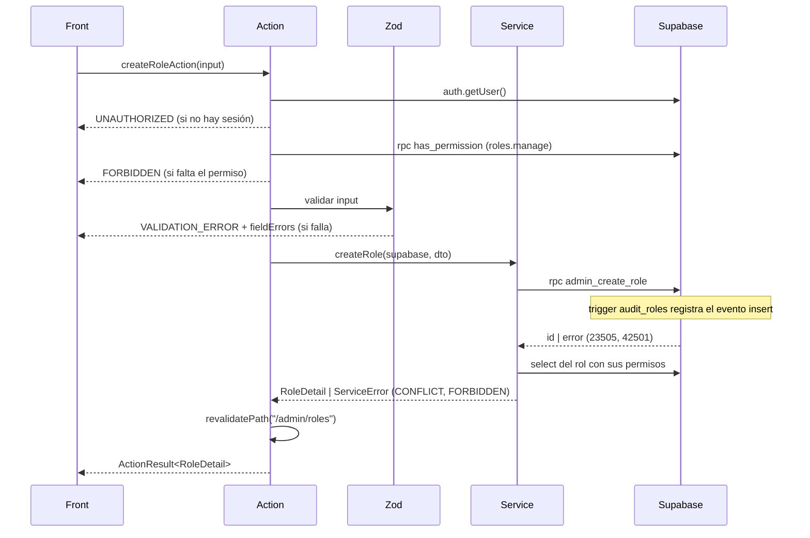

# createRole — Crear rol

| Campo           | Valor                                                                 |
| --------------- | --------------------------------------------------------------------- |
| Action          | `src/actions/roles/createRole.action.ts` (exporta `createRoleAction`) |
| Schema          | `src/core/schemas/roles/createRole.schema.ts`                         |
| Servicio        | `src/core/services/roles/createRole.service.ts`                       |
| Permiso         | Sesión activa y permiso `roles.manage`                                |
| Equivalente API | No aplica                                                             |

Definición funcional: [HU-ROL-001](../../historias_de_usuario/roles/HU_crear_rol.md). El Servicio llama a la RPC `admin_create_role` (D13), porque `roles` no tiene `INSERT` directo.

## Uso desde el front

| Import             | Ruta                                     | Para qué                                                                                     |
| ------------------ | ---------------------------------------- | -------------------------------------------------------------------------------------------- |
| `createRoleAction` | `src/actions/roles/createRole.action.ts` | Se llama desde el formulario de alta (`/admin/roles/new`)                                    |
| `ActionResult<T>`  | `src/core/types/action-result.ts`        | Tipa la respuesta; se discrimina por `ok` para leer `data` o `error` (`code`, `fieldErrors`) |
| `RoleDetail`       | `src/core/types/roles/role.types.ts`     | Tipo de `data` en el caso de éxito (`ActionResult<RoleDetail>`)                              |
| `CreateRoleInput`  | `src/core/types/roles/role.types.ts`     | Tipo del input                                                                               |

**Por qué solo esto:** el schema Zod y el Servicio son del back. El formulario puede validar antes de enviar, pero es solo una ayuda de experiencia; la validación real la hacen la Action y la base.

```tsx
const result = await createRoleAction(input)

if (!result.ok) {
  // result.error.code, result.error.message, result.error.fieldErrors?
  // CONFLICT: ya existe un rol con ese código o ese nombre
  return
}

// result.data: RoleDetail (permissions: [])
```

## Input

| Campo         | Tipo             | Reglas                                                                                   | Requerido |
| ------------- | ---------------- | ---------------------------------------------------------------------------------------- | --------- |
| `code`        | `string`         | Se recorta; 2–50 caracteres; `^[a-z][a-z0-9_.-]{1,49}$` (no se pasa a minúsculas); único | Sí        |
| `name`        | `string`         | Se recorta; 2–60 caracteres; único sin distinguir mayúsculas/minúsculas                  | Sí        |
| `description` | `string \| null` | Se recorta; 1–250 caracteres si se envía; `null` u omitido = sin descripción             | No        |

Campos que **no** se reciben: `is_active` (siempre `true`), `is_system` (siempre `false`), `id`, `created_at` y `updated_at`. Si llegan, se ignoran. Los permisos se definen con `setRolePermissions`.

```json
{
  "code": "cashier",
  "name": "Cajero",
  "description": "Cobra pedidos y cierra la caja"
}
```

## Éxito

`ActionResult<RoleDetail>`

- Devuelve el rol creado, activo y con `permissions` vacío.

```json
{
  "ok": true,
  "data": {
    "id": "c4e19d27-6f03-4a85-b2d8-91a7e3f05c62",
    "code": "cashier",
    "name": "Cajero",
    "description": "Cobra pedidos y cierra la caja",
    "is_system": false,
    "is_active": true,
    "created_at": "2026-11-23T14:05:00Z",
    "permissions": []
  },
  "message": "Rol creado"
}
```

## Errores

| code               | Cuándo                                                                     | message                            | HTTP (API) |
| ------------------ | -------------------------------------------------------------------------- | ---------------------------------- | ---------- |
| `VALIDATION_ERROR` | Falla el schema (código con formato inválido, nombre fuera de rango, etc.) | Datos inválidos                    | 400        |
| `UNAUTHORIZED`     | Sin sesión                                                                 | Sesión requerida                   | 401        |
| `FORBIDDEN`        | No tiene `roles.manage`, o la RPC rechaza por permisos (`42501`)           | No tenés permiso para crear roles  | 403        |
| `CONFLICT`         | El `code` ya existe (`roles_code_key`)                                     | Ya existe un rol con ese código    | 409        |
| `CONFLICT`         | El `name` ya existe sin distinguir mayúsculas (`roles_name_lower_key`)     | Ya existe un rol con ese nombre    | 409        |
| `INTERNAL_ERROR`   | Falla inesperada                                                           | Error inesperado. Intentá de nuevo | 500        |

```json
{
  "ok": false,
  "error": {
    "code": "VALIDATION_ERROR",
    "message": "Datos inválidos",
    "fieldErrors": {
      "code": [
        "El código debe empezar con una letra minúscula y usar solo minúsculas, números, _ . o -"
      ]
    }
  }
}
```

No usa `NOT_FOUND`.

## Reglas de negocio aplicadas

- La RPC inserta con `is_system = false` e `is_active = true`; el cliente no puede cambiarlo.
- La unicidad de `code` y de `lower(name)` la garantiza la base. El Servicio traduce `23505` a `CONFLICT` y distingue el mensaje por el nombre de la constraint que trae `error.message` (igual de frágil que `slug` en `createCategory`: si se renombra la constraint, ajustarlo).
- El `code` no se normaliza: la base lo rechaza si tiene mayúsculas (`roles_code_format`).
- Después de insertar, el Servicio lee el rol con la misma consulta que `getRole` para devolver un `RoleDetail`.
- **Permiso:** la Action comprueba la sesión y `roles.manage` con `requirePermission` antes de validar con Zod; la RPC lo vuelve a exigir.

## Validación por capa

- **Action (antes de Zod):** sesión (`UNAUTHORIZED`) y permiso `roles.manage` (`FORBIDDEN`).
- **Zod en la Action:** recorte, formato y longitud de `code`, `name` y `description`.
- **Servicio:** RPC, traducción de `23505` y `42501`, y lectura del rol creado.
- **Base de datos:** `roles_code_format`, `roles_name_length`, `roles_description_length`, unicidad de `code` y `lower(name)`, y el trigger `audit_roles`.

## Efectos secundarios

- Tras el alta, se llama a `revalidatePath("/admin/roles")`.
- La base registra el alta en `audit_logs` (evento `insert`, con `new_data` y el actor) mediante el trigger `audit_roles`.

## Flujo



## Estado de implementación

- **Implementado:** nada (documentación de la Fase 6). La tabla, sus `CHECK` y el trigger de auditoría ya existen.
- **Pendiente:** RPC `admin_create_role`, schema, Servicio, Action, tipos y el formulario.
