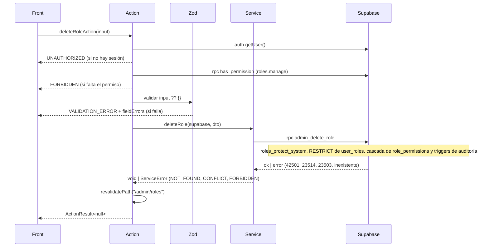

# deleteRole — Eliminar rol

| Campo           | Valor                                                                 |
| --------------- | --------------------------------------------------------------------- |
| Action          | `src/actions/roles/deleteRole.action.ts` (exporta `deleteRoleAction`) |
| Schema          | `src/core/schemas/roles/deleteRole.schema.ts`                         |
| Servicio        | `src/core/services/roles/deleteRole.service.ts`                       |
| Permiso         | Sesión activa y permiso `roles.manage`                                |
| Equivalente API | No aplica                                                             |

Definición funcional: [HU-ROL-005](../../historias_de_usuario/roles/HU_eliminar_rol.md). El Servicio llama a la RPC `admin_delete_role` (D13), porque `roles` no tiene `DELETE` directo.

A diferencia de `deleteCategory`, es un **borrado físico**: `roles` no tiene baja lógica (se desactiva con `is_active`, D6). Solo se puede eliminar un rol que no es del sistema y que ningún usuario tiene asignado.

## Uso desde el front

| Import             | Ruta                                     | Para qué                                                                                     |
| ------------------ | ---------------------------------------- | -------------------------------------------------------------------------------------------- |
| `deleteRoleAction` | `src/actions/roles/deleteRole.action.ts` | Se llama desde el botón "Eliminar" de `/admin/roles` con el `id` del rol                     |
| `ActionResult<T>`  | `src/core/types/action-result.ts`        | Tipa la respuesta; se discrimina por `ok` para leer `data` o `error` (`code`, `fieldErrors`) |
| `DeleteRoleInput`  | `src/core/types/roles/role.types.ts`     | Tipo del input (`{ id }`)                                                                    |

**Por qué `data` es `null`:** el rol ya no existe tras la operación, así que no hay nada que devolver. El front quita el rol de su lista (la Action ya revalida `/admin/roles`).

**Qué hacer en el front:** mostrar "Eliminar" solo para roles que no son del sistema. Si el rol está en uso, ofrecer desactivarlo (`updateRoleAction` con `is_active: false`) en lugar de eliminarlo. Aun así, el front no es la barrera: la Action rechaza con `CONFLICT` un rol del sistema o en uso.

```tsx
const result = await deleteRoleAction({ id })

if (!result.ok) {
  // result.error.code, result.error.message, result.error.fieldErrors?
  // NOT_FOUND: el rol no existe
  // CONFLICT: es un rol del sistema o está asignado a algún usuario
  return
}

// result.data: null
```

## Input

| Campo | Tipo     | Reglas      | Requerido |
| ----- | -------- | ----------- | --------- |
| `id`  | `string` | UUID válido | Sí        |

```json
{ "id": "c4e19d27-6f03-4a85-b2d8-91a7e3f05c62" }
```

## Éxito

`ActionResult<null>`

```json
{ "ok": true, "data": null, "message": "Rol eliminado" }
```

## Errores

| code               | Cuándo                                                                                                                   | message                                                                        | HTTP (API) |
| ------------------ | ------------------------------------------------------------------------------------------------------------------------ | ------------------------------------------------------------------------------ | ---------- |
| `VALIDATION_ERROR` | Falla el schema (`id` ausente o no es un UUID)                                                                           | Datos inválidos                                                                | 400        |
| `UNAUTHORIZED`     | Sin sesión                                                                                                               | Sesión requerida                                                               | 401        |
| `FORBIDDEN`        | No tiene `roles.manage`, o la RPC rechaza por permisos (`42501`)                                                         | No tenés permiso para eliminar roles                                           | 403        |
| `NOT_FOUND`        | No existe un rol con ese `id`                                                                                            | Rol no encontrado                                                              | 404        |
| `CONFLICT`         | El rol es del sistema (`23514` de `roles_protect_system`)                                                                | No se puede eliminar un rol del sistema                                        | 409        |
| `CONFLICT`         | El rol está asignado a algún usuario, de cualquier estado, aunque el rol esté inactivo (`23503` de `ON DELETE RESTRICT`) | El rol está asignado a usuarios. Desasignalo o desactivalo antes de eliminarlo | 409        |
| `INTERNAL_ERROR`   | Falla inesperada                                                                                                         | Error inesperado. Intentá de nuevo                                             | 500        |

```json
{
  "ok": false,
  "error": {
    "code": "CONFLICT",
    "message": "No se puede eliminar un rol del sistema"
  }
}
```

```json
{
  "ok": false,
  "error": {
    "code": "VALIDATION_ERROR",
    "message": "Datos inválidos",
    "fieldErrors": {
      "id": ["El id debe ser un UUID válido"]
    }
  }
}
```

## Reglas de negocio aplicadas

- **Borrado físico, solo de roles que no son del sistema y sin asignaciones.** Los permisos que el rol tenía (`role_permissions`) se eliminan con él (`ON DELETE CASCADE`). Los permisos del catálogo (`permissions`) no se modifican.
- **Un rol del sistema no se elimina.** Lo aplica el trigger `roles_protect_system` (F5.3) con `23514`, para todos, incluidas las migraciones y el SQL Editor.
- **Un rol asignado no se elimina.** Aplica a cualquier usuario, de cualquier estado, y también a un rol inactivo. Lo garantiza la base con `ON DELETE RESTRICT` en `user_roles.role_id`: si una asignación llega mientras se elimina el rol, el rol no se elimina y se informa `CONFLICT` (`23503`).
- **Cómo se distinguen los rechazos.** El Servicio traduce `23514` a `CONFLICT` "rol del sistema" y `23503` a `CONFLICT` "rol asignado". Si un rol cumple ambas condiciones, se informa el del sistema (a confirmar; la HU no lo define).
- Al eliminarse, su `code` y su `name` quedan libres para un rol nuevo.
- **Permiso:** la Action comprueba la sesión y `roles.manage` con `requirePermission` antes de validar con Zod; la RPC lo vuelve a exigir.
- **Pendiente de confirmar:** que el borrado en cascada de `role_permissions` pase por el trigger anti-escalada (F5.4) sin bloquear un borrado legítimo. Como el rol no puede estar asignado a nadie, tampoco al actor, no debería bloquearse.

## Validación por capa

- **Action (antes de Zod):** sesión (`UNAUTHORIZED`) y permiso `roles.manage` (`FORBIDDEN`).
- **Zod en la Action:** `id` presente y con formato UUID.
- **Servicio:** llamada a la RPC y traducción de `42501`, `23514`, `23503` y rol inexistente (`NOT_FOUND`).
- **Base de datos:** `roles_protect_system`, `ON DELETE RESTRICT` desde `user_roles`, `ON DELETE CASCADE` desde `role_permissions` y los triggers de auditoría `audit_roles` y `audit_role_permissions`.

## Efectos secundarios

- Tras eliminar, se llama a `revalidatePath("/admin/roles")`.
- La base registra la eliminación en `audit_logs` mediante los triggers `audit_role_permissions` y `audit_roles`: un evento `delete` por cada permiso que el rol tenía (`record_id` `"role_id:permission_code"`) y uno por el rol, con su fila anterior en `old_data` y el usuario de la sesión como `actor_id`. Lo hacen los triggers, no la Action ni el Servicio.

## Flujo



## Estado de implementación

- **Implementado:** las protecciones de la base (`roles_protect_system`, `ON DELETE RESTRICT` y `CASCADE`) y los triggers de auditoría (F4); nada propio de la operación.
- **Implementado (F6.2, 2026-11-22):** RPC `admin_delete_role` (si es del sistema y además está asignado prevalece `23514`; asignado: `23503`; `42501` sin permiso, `P0002` inexistente, `23505`/`23514`/`23503` conflictos (el Servicio los traduce)).
- **Pendiente:** schema, Servicio, Action, tipos y el botón en `/admin/roles`.
- **A confirmar (HU-ROL-005):** el borrado físico frente a permitir solo desactivar, y qué mensaje prevalece si el rol es del sistema y además está asignado.
