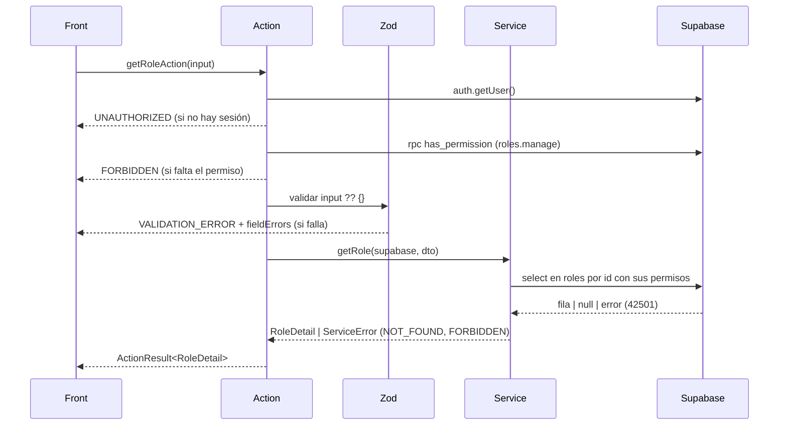

# getRole — Obtener rol

| Campo           | Valor                                                           |
| --------------- | --------------------------------------------------------------- |
| Action          | `src/actions/roles/getRole.action.ts` (exporta `getRoleAction`) |
| Schema          | `src/core/schemas/roles/getRole.schema.ts`                      |
| Servicio        | `src/core/services/roles/getRole.service.ts`                    |
| Permiso         | Sesión activa y permiso `roles.manage`                          |
| Equivalente API | No aplica                                                       |

Definición funcional: [HU-ROL-003](../../historias_de_usuario/roles/HU_obtener_rol.md). Lectura directa de `roles` con sus permisos (`role_permissions` y `permissions`) con RLS; no necesita RPC. Esta misma consulta la reutilizan `createRole`, `updateRole` y `setRolePermissions` para devolver el rol.

## Uso desde el front

| Import            | Ruta                                  | Para qué                                                                                     |
| ----------------- | ------------------------------------- | -------------------------------------------------------------------------------------------- |
| `getRoleAction`   | `src/actions/roles/getRole.action.ts` | Se llama desde la vista de detalle o de edición con el `id` del rol                          |
| `ActionResult<T>` | `src/core/types/action-result.ts`     | Tipa la respuesta; se discrimina por `ok` para leer `data` o `error` (`code`, `fieldErrors`) |
| `RoleDetail`      | `src/core/types/roles/role.types.ts`  | Tipo de `data` en el caso de éxito (`ActionResult<RoleDetail>`)                              |
| `RolePermission`  | `src/core/types/roles/role.types.ts`  | Tipo de cada permiso de `RoleDetail.permissions`: `code`, `module`, `name`                   |
| `GetRoleInput`    | `src/core/types/roles/role.types.ts`  | Tipo del input (`id`)                                                                        |

```tsx
const result = await getRoleAction({ id })

if (!result.ok) {
  // result.error.code, result.error.message, result.error.fieldErrors?
  // NOT_FOUND: el rol no existe
  return
}

// result.data: RoleDetail
```

## Input

| Campo | Tipo     | Reglas      | Requerido |
| ----- | -------- | ----------- | --------- |
| `id`  | `string` | UUID válido | Sí        |

```json
{ "id": "8a2f4c10-5b9e-4d3a-a6c1-2e7b9d0f1a34" }
```

## Éxito

`ActionResult<RoleDetail>`

- `permissions` se ordena por `module` y, a igual módulo, por `name`. Un rol sin permisos devuelve `[]`.
- Un rol inactivo lista sus permisos aunque no se apliquen mientras esté inactivo.

```json
{
  "ok": true,
  "data": {
    "id": "8a2f4c10-5b9e-4d3a-a6c1-2e7b9d0f1a34",
    "code": "admin",
    "name": "Administrador",
    "description": "Acceso total al sistema",
    "is_system": true,
    "is_active": true,
    "created_at": "2026-11-21T13:41:18Z",
    "permissions": [
      { "code": "admin.access", "module": "admin", "name": "Acceder al panel" },
      { "code": "audit.read", "module": "audit", "name": "Consultar auditoría" }
    ]
  },
  "message": "Rol obtenido"
}
```

## Errores

| code               | Cuándo                                                    | message                            | HTTP (API) |
| ------------------ | --------------------------------------------------------- | ---------------------------------- | ---------- |
| `VALIDATION_ERROR` | Falla el schema (`id` ausente o no es un UUID)            | Datos inválidos                    | 400        |
| `UNAUTHORIZED`     | Sin sesión                                                | Sesión requerida                   | 401        |
| `FORBIDDEN`        | No tiene `roles.manage`, o RLS o GRANT rechazan (`42501`) | No tenés permiso para ver roles    | 403        |
| `NOT_FOUND`        | No existe un rol con ese `id`                             | Rol no encontrado                  | 404        |
| `INTERNAL_ERROR`   | Falla inesperada                                          | Error inesperado. Intentá de nuevo | 500        |

```json
{ "ok": false, "error": { "code": "NOT_FOUND", "message": "Rol no encontrado" } }
```

No usa `CONFLICT`: leer no depende de unicidad.

## Reglas de negocio aplicadas

- Los roles inactivos y los del sistema se obtienen con normalidad.
- El `id` se valida como UUID en la Action para evitar un error de sintaxis (`22P02`) en la base.
- Si RLS oculta la fila, la consulta no devuelve filas y el resultado es `NOT_FOUND`; si falta el `GRANT`, es `FORBIDDEN` (`42501`).
- **Permiso:** la Action exige `roles.manage` antes de validar. RLS lo refuerza para los permisos: `role_permissions` y `permissions` solo las lee quien tiene `roles.manage`.

## Efectos secundarios

Ninguno (lectura pura).

## Flujo



## Estado de implementación

- **Implementado:** nada (documentación de la Fase 6).
- **Pendiente:** schema, Servicio, Action, tipos y la pantalla de detalle.
