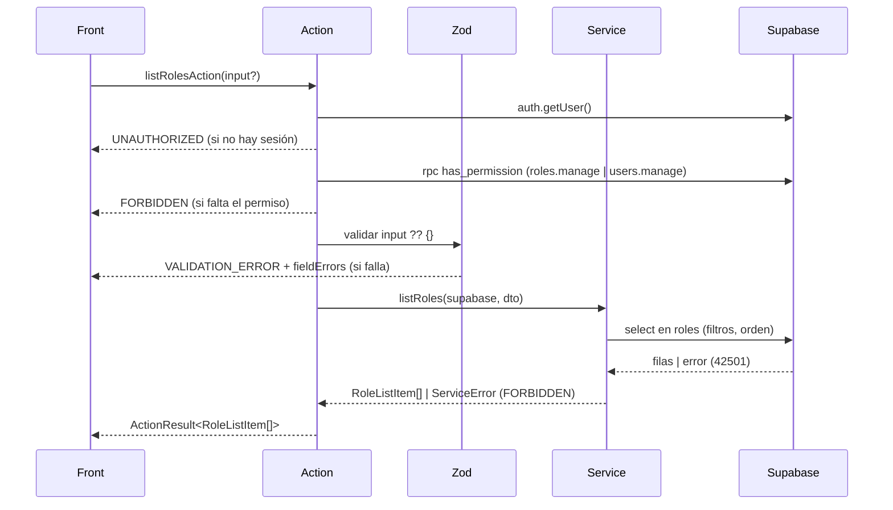

# listRoles — Listar roles

| Campo           | Valor                                                               |
| --------------- | ------------------------------------------------------------------- |
| Action          | `src/actions/roles/listRoles.action.ts` (exporta `listRolesAction`) |
| Schema          | `src/core/schemas/roles/listRoles.schema.ts`                        |
| Servicio        | `src/core/services/roles/listRoles.service.ts`                      |
| Permiso         | Sesión activa y permiso `roles.manage` o `users.manage`             |
| Equivalente API | No aplica                                                           |

Definición funcional: [HU-ROL-002](../../historias_de_usuario/roles/HU_listar_roles.md). Lectura directa de `roles` con RLS (`roles_select_active_users`); no necesita RPC.

## Uso desde el front

| Import            | Ruta                                    | Para qué                                                                                     |
| ----------------- | --------------------------------------- | -------------------------------------------------------------------------------------------- |
| `listRolesAction` | `src/actions/roles/listRoles.action.ts` | Se llama desde `/admin/roles` y desde los selectores de rol, con o sin filtros               |
| `ActionResult<T>` | `src/core/types/action-result.ts`       | Tipa la respuesta; se discrimina por `ok` para leer `data` o `error` (`code`, `fieldErrors`) |
| `RoleListItem`    | `src/core/types/roles/role.types.ts`    | Tipo de cada elemento de `data` (`ActionResult<RoleListItem[]>`)                             |
| `ListRolesInput`  | `src/core/types/roles/role.types.ts`    | Tipo del input (`search`, `is_active`)                                                       |

**Por qué `RoleListItem` y no `RoleDetail`:** el listado devuelve solo lo que necesita la tabla; los permisos y `created_at` están en el detalle (`getRole`).

```tsx
const result = await listRolesAction({ search, is_active })

if (!result.ok) {
  // result.error.code, result.error.message, result.error.fieldErrors?
  return
}

// result.data: RoleListItem[]  ([] si no hay resultados, no es un error)
```

## Input

Todo el input es opcional: `listRolesAction()` sin argumentos lista todos los roles.

| Campo       | Tipo      | Reglas                                                                                                                       | Requerido |
| ----------- | --------- | ---------------------------------------------------------------------------------------------------------------------------- | --------- |
| `search`    | `string`  | Se recorta; máximo 80 caracteres; vacío = sin filtro. Coincidencia parcial en `name`, sin distinguir mayúsculas (sí acentos) | No        |
| `is_active` | `boolean` | Si se envía, filtra por `is_active`. Si se omite, devuelve activos e inactivos                                               | No        |

Sin paginación por ahora. Si hiciera falta, `data` pasa a `{ items, total, page, page_size }` (cambio de contrato).

```json
{ "search": "caj", "is_active": true }
```

## Éxito

`ActionResult<RoleListItem[]>`

- Orden fijo: `name` ascendente.
- Sin resultados no es un error: `data` es `[]`.
- No incluye `created_at` ni permisos.

```json
{
  "ok": true,
  "data": [
    {
      "id": "8a2f4c10-5b9e-4d3a-a6c1-2e7b9d0f1a34",
      "code": "admin",
      "name": "Administrador",
      "description": "Acceso total al sistema",
      "is_system": true,
      "is_active": true
    }
  ],
  "message": "Roles obtenidos"
}
```

## Errores

| code               | Cuándo                                                                      | message                            | HTTP (API) |
| ------------------ | --------------------------------------------------------------------------- | ---------------------------------- | ---------- |
| `VALIDATION_ERROR` | Falla el schema (`search` demasiado largo, `is_active` no booleano)         | Datos inválidos                    | 400        |
| `UNAUTHORIZED`     | Sin sesión                                                                  | Sesión requerida                   | 401        |
| `FORBIDDEN`        | No tiene `roles.manage` ni `users.manage`, o RLS o GRANT rechazan (`42501`) | No tenés permiso para ver roles    | 403        |
| `INTERNAL_ERROR`   | Falla inesperada                                                            | Error inesperado. Intentá de nuevo | 500        |

```json
{
  "ok": false,
  "error": {
    "code": "VALIDATION_ERROR",
    "message": "Datos inválidos",
    "fieldErrors": { "search": ["La búsqueda no puede superar los 80 caracteres"] }
  }
}
```

No usa `NOT_FOUND` ni `CONFLICT`: listar nunca falla por ausencia de datos ni por unicidad.

## Reglas de negocio aplicadas

- `%`, `_` y `\` de `search` se tratan como texto literal (el Servicio los escapa, igual que `listCategories`).
- El listado incluye los roles inactivos y los del sistema.
- **Permiso:** la Action exige `roles.manage` o `users.manage` antes de validar. RLS lo refuerza: `roles` lo lee cualquier perfil `active`, por lo que la Action es la barrera que restringe el acceso a quienes gestionan roles o usuarios.

## Efectos secundarios

Ninguno (lectura pura).

## Flujo



## Estado de implementación

- **Implementado:** nada (documentación de la Fase 6).
- **Pendiente:** schema, Servicio, Action, tipos y la pantalla `/admin/roles`.
