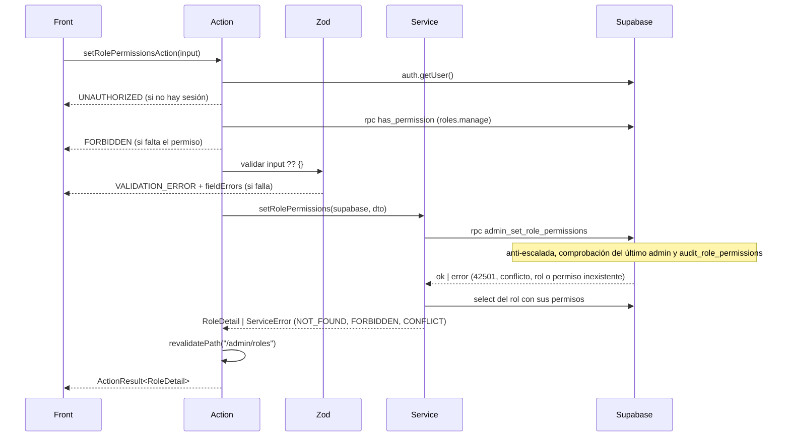

# setRolePermissions — Definir los permisos de un rol

| Campo           | Valor                                                                                 |
| --------------- | ------------------------------------------------------------------------------------- |
| Action          | `src/actions/roles/setRolePermissions.action.ts` (exporta `setRolePermissionsAction`) |
| Schema          | `src/core/schemas/roles/setRolePermissions.schema.ts`                                 |
| Servicio        | `src/core/services/roles/setRolePermissions.service.ts`                               |
| Permiso         | Sesión activa y permiso `roles.manage`                                                |
| Equivalente API | No aplica                                                                             |

Definición funcional: [HU-ROL-006](../../historias_de_usuario/roles/HU_definir_permisos_rol.md). El Servicio llama a la RPC `admin_set_role_permissions` (D13), porque `role_permissions` no tiene escritura directa. Es la operación más sensible del módulo: define quién puede hacer qué.

La operación **reemplaza el conjunto completo** de permisos del rol: al terminar, el rol tiene exactamente los permisos enviados.

## Uso desde el front

| Import                     | Ruta                                             | Para qué                                                                                     |
| -------------------------- | ------------------------------------------------ | -------------------------------------------------------------------------------------------- |
| `setRolePermissionsAction` | `src/actions/roles/setRolePermissions.action.ts` | Se llama desde la pantalla de permisos del rol con el `role_id` y la lista final de códigos  |
| `ActionResult<T>`          | `src/core/types/action-result.ts`                | Tipa la respuesta; se discrimina por `ok` para leer `data` o `error` (`code`, `fieldErrors`) |
| `RoleDetail`               | `src/core/types/roles/role.types.ts`             | Tipo de `data` en el caso de éxito (`ActionResult<RoleDetail>`)                              |
| `SetRolePermissionsInput`  | `src/core/types/roles/role.types.ts`             | Tipo del input (`role_id`, `permission_codes`)                                               |

**Por qué se envía la lista completa y no un permiso a la vez:** la pantalla muestra casillas por permiso; el front manda el estado final marcado y la RPC aplica solo la diferencia en una única transacción. Así nunca queda un rol a medias.

**Qué hacer en el front:** para quitar todos los permisos se envía `permission_codes: []`. El selector necesita el catálogo de permisos, que solo lee quien tiene `roles.manage`; hoy no hay una Action que lo exponga (ver "Estado de implementación").

```tsx
const result = await setRolePermissionsAction({ role_id, permission_codes })

if (!result.ok) {
  // result.error.code, result.error.message, result.error.fieldErrors?
  // FORBIDDEN: no tiene roles.manage, o el rol está asignado al propio usuario
  // NOT_FOUND: el rol o algún permiso no existen
  // CONFLICT: se quitaría admin.access y el sistema se quedaría sin administrador
  return
}

// result.data: RoleDetail (con permissions actualizados)
```

## Input

| Campo              | Tipo       | Reglas                                                                                                                   | Requerido |
| ------------------ | ---------- | ------------------------------------------------------------------------------------------------------------------------ | --------- |
| `role_id`          | `string`   | UUID válido                                                                                                              | Sí        |
| `permission_codes` | `string[]` | Cada código con formato `modulo.accion` (`^[a-z][a-z0-9_]*\.[a-z][a-z0-9_]*$`); los repetidos se ignoran; puede ser `[]` | Sí        |

Campos que **no** se reciben: cualquier otro dato del rol (`code`, `name`, `description`, `is_active` e `is_system` se modifican con `updateRole`, y nunca `is_system`). Si llegan, se ignoran.

```json
{
  "role_id": "c4e19d27-6f03-4a85-b2d8-91a7e3f05c62",
  "permission_codes": ["categories.read", "categories.manage"]
}
```

## Éxito

`ActionResult<RoleDetail>`

- Devuelve el rol con sus permisos ya actualizados, con la misma forma que `getRole`.
- `permissions` se ordena por `module` y, a igual módulo, por `name`. Con `permission_codes: []`, `permissions` es `[]`.
- Si el rol ya tenía exactamente esos permisos, también es éxito: no cambia nada y no genera eventos de auditoría.

```json
{
  "ok": true,
  "data": {
    "id": "c4e19d27-6f03-4a85-b2d8-91a7e3f05c62",
    "code": "cashier",
    "name": "Cajero",
    "description": "Cobra pedidos y cierra la caja",
    "is_system": false,
    "is_active": true,
    "created_at": "2026-11-23T14:05:00Z",
    "permissions": [
      { "code": "categories.manage", "module": "categories", "name": "Gestionar categorías" },
      { "code": "categories.read", "module": "categories", "name": "Ver categorías" }
    ]
  },
  "message": "Permisos del rol actualizados"
}
```

## Errores

| code               | Cuándo                                                                                                                  | message                                                      | HTTP (API) |
| ------------------ | ----------------------------------------------------------------------------------------------------------------------- | ------------------------------------------------------------ | ---------- |
| `VALIDATION_ERROR` | Falla el schema (`role_id` inválido, `permission_codes` ausente o no es una lista, o algún código con formato inválido) | Datos inválidos                                              | 400        |
| `UNAUTHORIZED`     | Sin sesión                                                                                                              | Sesión requerida                                             | 401        |
| `FORBIDDEN`        | No tiene `roles.manage`                                                                                                 | No tenés permiso para modificar permisos de roles            | 403        |
| `FORBIDDEN`        | El rol está asignado al propio usuario (`42501` de la anti-escalada)                                                    | No podés modificar los permisos de un rol que tenés asignado | 403        |
| `NOT_FOUND`        | No existe un rol con ese `role_id`                                                                                      | Rol no encontrado                                            | 404        |
| `NOT_FOUND`        | Algún código no existe en el catálogo de permisos                                                                       | Permiso no encontrado                                        | 404        |
| `CONFLICT`         | Se quitaría `admin.access` y el sistema se quedaría sin administrador (lo valida la RPC)                                | No se puede dejar al sistema sin administrador               | 409        |
| `INTERNAL_ERROR`   | Falla inesperada                                                                                                        | Error inesperado. Intentá de nuevo                           | 500        |

```json
{
  "ok": false,
  "error": {
    "code": "FORBIDDEN",
    "message": "No podés modificar los permisos de un rol que tenés asignado"
  }
}
```

```json
{
  "ok": false,
  "error": {
    "code": "NOT_FOUND",
    "message": "Permiso no encontrado"
  }
}
```

## Reglas de negocio aplicadas

- **Reemplazo atómico.** La RPC calcula la diferencia (agrega los que faltan, quita los que sobran) y la aplica en una sola transacción: o se aplica todo o no cambia nada. Si algún código no existe, no cambia nada.
- **Idempotente.** Si el rol ya tiene exactamente esos permisos, responde con éxito y no escribe ni audita nada.
- **Anti-escalada (F5.4).** Con `auth.uid()`, el trigger `role_permissions_protect_assignments` exige `roles.manage` y rechaza con `42501` tocar los permisos de un rol que el propio actor tiene asignado, aunque sea administrador. El Servicio distingue ese caso del permiso faltante por el texto del error (igual de frágil que `slug` en `createCategory`: si se cambia el mensaje de la RPC, ajustarlo).
- **Último administrador.** La guardia de F5.5 no cubre quitar `admin.access` de `role_permissions` (límite conocido). La RPC debe comprobar que, tras el cambio, siga existiendo un perfil `active` con un rol activo que tenga `admin.access`, y rechazar con un error que el Servicio traduzca a `CONFLICT`.
- Se pueden definir los permisos de un rol inactivo: quedan guardados pero no se aplican mientras esté inactivo (`has_permission` exige rol activo).
- **Sin caché:** el cambio rige desde la solicitud siguiente.
- `permission_code` referencia `permissions(code)` con `ON UPDATE CASCADE ON DELETE RESTRICT`; el catálogo no se modifica desde esta operación.
- **Permiso:** la Action comprueba la sesión y `roles.manage` con `requirePermission` antes de validar con Zod; la RPC y el trigger lo vuelven a exigir.
- **Pendiente de decidir:** si se pueden modificar los permisos de un rol del sistema como `admin`. Hoy solo lo frenan el trigger anti-escalada (para quien lo tiene asignado) y la comprobación del último administrador.

## Validación por capa

- **Action (antes de Zod):** sesión (`UNAUTHORIZED`) y permiso `roles.manage` (`FORBIDDEN`).
- **Zod en la Action:** UUID del `role_id` y lista de códigos con formato `modulo.accion` (los repetidos se ignoran).
- **Servicio:** llamada a la RPC, traducción de `42501` (dos mensajes), `23514`/conflicto del último administrador y rol o permiso inexistente (`NOT_FOUND`), y lectura del rol actualizado con la misma consulta que `getRole`.
- **Base de datos:** claves foráneas de `role_permissions`, trigger `role_permissions_protect_assignments` y los triggers de auditoría `audit_role_permissions`.

## Efectos secundarios

- Tras el cambio, se llama a `revalidatePath("/admin/roles")`.
- La base registra cada permiso agregado o quitado en `audit_logs` (eventos `insert` y `delete`, con `record_id` `"role_id:permission_code"` y el usuario de la sesión como `actor_id`) mediante el trigger `audit_role_permissions`. Lo hace el trigger, no la Action ni el Servicio. Una llamada sin cambios no genera eventos.

## Flujo



## Estado de implementación

- **Implementado:** el trigger anti-escalada (F5.4) y los de auditoría (F4); nada propio de la operación.
- **Implementado (F6.2, 2026-11-22):** RPC `admin_set_role_permissions` (aplica solo la diferencia, idempotente, incluye la comprobación del último administrador, `23514`; código inexistente: `P0002`; `permission_codes` nulo: `22023`; `42501` sin permiso, `P0002` inexistente, `23505`/`23514`/`23503` conflictos (el Servicio los traduce)).
- **Pendiente:** schema, Servicio, Action, tipos y la pantalla de permisos del rol.
- **A confirmar (HU-ROL-006):** si hace falta una Action `listPermissions` para el selector (`permissions` solo la lee quien tiene `roles.manage`) y si se pueden modificar los permisos de un rol del sistema.
