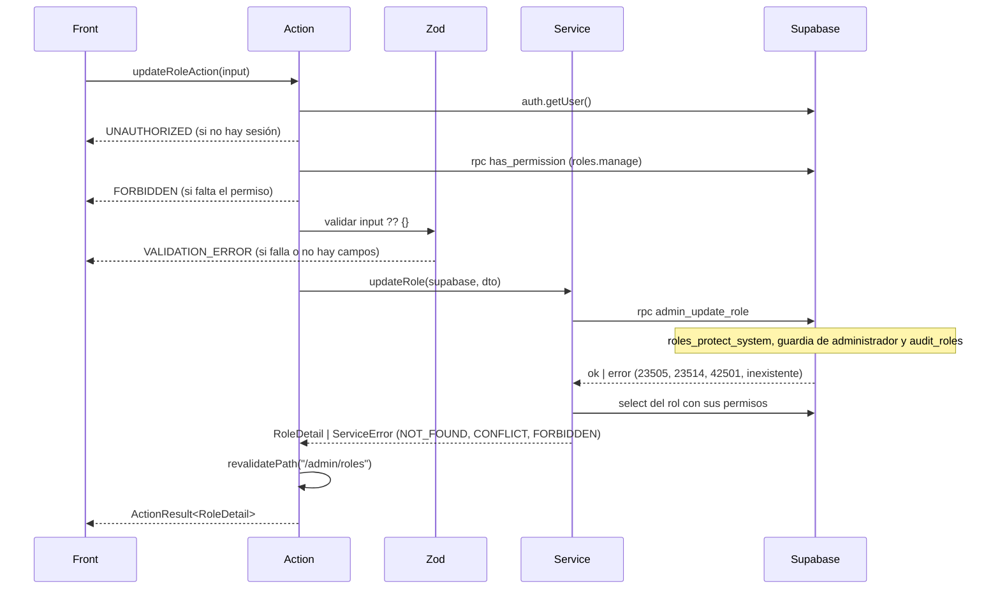

# updateRole — Modificar rol

| Campo           | Valor                                                                 |
| --------------- | --------------------------------------------------------------------- |
| Action          | `src/actions/roles/updateRole.action.ts` (exporta `updateRoleAction`) |
| Schema          | `src/core/schemas/roles/updateRole.schema.ts`                         |
| Servicio        | `src/core/services/roles/updateRole.service.ts`                       |
| Permiso         | Sesión activa y permiso `roles.manage`                                |
| Equivalente API | No aplica                                                             |

Definición funcional: [HU-ROL-004](../../historias_de_usuario/roles/HU_actualizar_rol.md). El Servicio llama a la RPC `admin_update_role` (D13), porque `roles` no tiene `UPDATE` directo.

## Uso desde el front

| Import             | Ruta                                     | Para qué                                                                                     |
| ------------------ | ---------------------------------------- | -------------------------------------------------------------------------------------------- |
| `updateRoleAction` | `src/actions/roles/updateRole.action.ts` | Se llama desde el formulario de edición con el `id` y los campos que cambiaron               |
| `ActionResult<T>`  | `src/core/types/action-result.ts`        | Tipa la respuesta; se discrimina por `ok` para leer `data` o `error` (`code`, `fieldErrors`) |
| `RoleDetail`       | `src/core/types/roles/role.types.ts`     | Tipo de `data` en el caso de éxito (`ActionResult<RoleDetail>`)                              |
| `UpdateRoleInput`  | `src/core/types/roles/role.types.ts`     | Tipo del input (`id` y los campos a modificar)                                               |

**Por qué es una actualización parcial:** el formulario envía solo lo que cambió. Un campo omitido no se modifica. Para quitar la descripción se envía `description: null`; omitirla la deja como está.

```tsx
const result = await updateRoleAction({ id, is_active: false })

if (!result.ok) {
  // result.error.code, result.error.message, result.error.fieldErrors?
  // NOT_FOUND: el rol no existe
  // CONFLICT: nombre repetido, rol del sistema o último administrador
  return
}

// result.data: RoleDetail
```

## Input

| Campo         | Tipo             | Reglas                                                                                          | Requerido |
| ------------- | ---------------- | ----------------------------------------------------------------------------------------------- | --------- |
| `id`          | `string`         | UUID válido                                                                                     | Sí        |
| `name`        | `string`         | Se recorta; 2–60 caracteres; no puede usarlo **otro** rol, sin distinguir mayúsculas/minúsculas | No        |
| `description` | `string \| null` | Se recorta; 1–250 caracteres si se envía; `null` quita la descripción                           | No        |
| `is_active`   | `boolean`        | `false` desactiva el rol (sus permisos dejan de aplicarse); `true` lo reactiva                  | No        |

**Regla del conjunto:** además de `id`, hay que enviar al menos un campo a modificar. Un input con solo `id` es `VALIDATION_ERROR`.

Campos que **no** se reciben: `code` (identificador técnico, no editable), `is_system`, `created_at` y `updated_at`. Si llegan, se ignoran.

```json
{ "id": "c4e19d27-6f03-4a85-b2d8-91a7e3f05c62", "name": "Cajero/a", "description": null }
```

## Éxito

`ActionResult<RoleDetail>`

- Devuelve el rol ya modificado, con sus permisos, con los mismos campos que `getRole`.

```json
{
  "ok": true,
  "data": {
    "id": "c4e19d27-6f03-4a85-b2d8-91a7e3f05c62",
    "code": "cashier",
    "name": "Cajero/a",
    "description": null,
    "is_system": false,
    "is_active": true,
    "created_at": "2026-11-23T14:05:00Z",
    "permissions": []
  },
  "message": "Rol actualizado"
}
```

## Errores

| code               | Cuándo                                                                         | message                                                | HTTP (API) |
| ------------------ | ------------------------------------------------------------------------------ | ------------------------------------------------------ | ---------- |
| `VALIDATION_ERROR` | Falla el schema, o no se envía ningún campo a modificar                        | Datos inválidos / Enviá al menos un campo              | 400        |
| `UNAUTHORIZED`     | Sin sesión                                                                     | Sesión requerida                                       | 401        |
| `FORBIDDEN`        | No tiene `roles.manage`, o la RPC rechaza por permisos (`42501`)               | No tenés permiso para modificar roles                  | 403        |
| `NOT_FOUND`        | No existe un rol con ese `id`                                                  | Rol no encontrado                                      | 404        |
| `CONFLICT`         | El `name` ya lo usa **otro** rol (`roles_name_lower_key`)                      | Ya existe un rol con ese nombre                        | 409        |
| `CONFLICT`         | Se desactiva un rol del sistema (`23514` de `roles_protect_system`)            | No se puede desactivar un rol del sistema              | 409        |
| `CONFLICT`         | Se desactiva un rol y el sistema se queda sin administrador (lo valida la RPC) | No se puede desactivar el rol del último administrador | 409        |
| `INTERNAL_ERROR`   | Falla inesperada                                                               | Error inesperado. Intentá de nuevo                     | 500        |

Cuando falla la regla del conjunto, `fieldErrors` queda vacío y `message` trae el motivo (`Enviá al menos un campo para modificar`).

```json
{
  "ok": false,
  "error": { "code": "CONFLICT", "message": "No se puede desactivar un rol del sistema" }
}
```

## Reglas de negocio aplicadas

- Se pueden modificar roles en cualquier estado. Un rol no choca consigo misma: la base no compara una fila contra sí misma, así que conservar el `name` o cambiar solo las mayúsculas no genera conflicto.
- **Rol del sistema:** se pueden cambiar `name` y `description`; `roles_protect_system` rechaza con `23514` desactivarlo (y también cambiar `code` o `is_system`, que esta operación nunca envía).
- **Último administrador:** la guardia de F5.5 no cubre desactivar un rol no sistema que da `admin.access`. La RPC debe comprobar que, tras el cambio, siga existiendo un perfil `active` con un rol activo que tenga `admin.access`, y rechazar con un error que el Servicio traduzca a `CONFLICT`.
- Desactivar no borra asignaciones ni permisos: los permisos dejan de aplicarse desde la solicitud siguiente (`has_permission` exige rol activo).
- La RPC debe distinguir un campo omitido de `null` (por ejemplo, con un parámetro que indique si se envió `description`).
- `updated_at` lo actualiza el trigger `roles_set_updated_at` y no se detecta "sin cambios": la fila se actualiza igual. Concurrencia: gana la última escritura.
- La base replica los límites con `roles_name_length` y `roles_description_length`.
- **Permiso:** la Action comprueba `roles.manage` antes de validar; la RPC lo vuelve a exigir.

## Validación por capa

- **Action (antes de Zod):** sesión (`UNAUTHORIZED`) y permiso `roles.manage` (`FORBIDDEN`).
- **Zod en la Action:** UUID del `id`, recorte y longitud de `name` y `description`, booleano de `is_active` y al menos un campo.
- **Servicio:** RPC, traducción de `23505`, `23514`, `42501` y rol inexistente (`NOT_FOUND`), y lectura del rol modificado.
- **Base de datos:** `CHECK` de longitud, unicidad de `lower(name)`, `roles_protect_system` y el trigger `audit_roles`.

## Efectos secundarios

- Tras modificar, se llama a `revalidatePath("/admin/roles")`.
- La base registra el cambio en `audit_logs` (evento `update`, con `old_data`, `new_data` y el actor) mediante el trigger `audit_roles`.

## Flujo



## Estado de implementación

- **Implementado:** `roles_protect_system` (F5.3) y el trigger de auditoría (F4).
- **Implementado (F6.2, 2026-11-22):** RPC `admin_update_role` (parcial; `p_set_description` distingue omitido de `null`; incluye la comprobación del último administrador, `23514`; `42501` sin permiso, `P0002` inexistente, `23505`/`23514`/`23503` conflictos (el Servicio los traduce)).
- **Pendiente:** schema, Servicio, Action, tipos y el formulario de edición.
