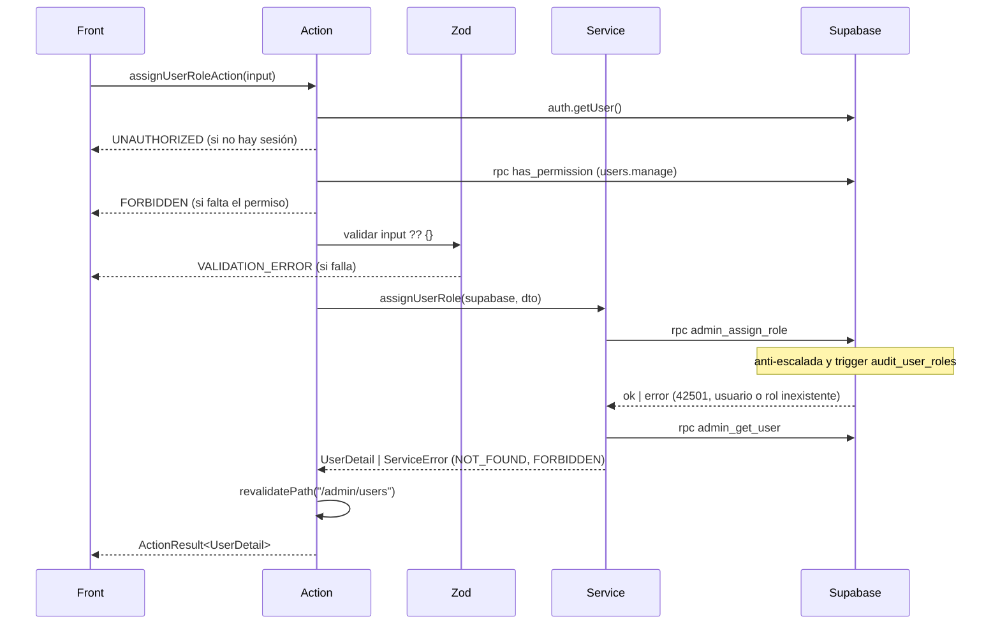

# assignUserRole — Asignar un rol a un usuario

| Campo           | Valor                                                                                           |
| --------------- | ----------------------------------------------------------------------------------------------- |
| Action          | `src/actions/users/assignUserRole.action.ts` (exporta `assignUserRoleAction`)                   |
| Schema          | `src/core/schemas/users/userRole.schema.ts` (`userRoleSchema`, compartido con `removeUserRole`) |
| Servicio        | `src/core/services/users/assignUserRole.service.ts`                                             |
| Permiso         | Sesión activa y permiso `users.manage`                                                          |
| Equivalente API | No aplica                                                                                       |

Definición funcional: [HU-USR-006](../../historias_de_usuario/users/HU_asignar_roles_usuario.md). El Servicio llama a la RPC `admin_assign_role` (D13).

## Uso desde el front

| Import                 | Ruta                                         | Para qué                                                                                     |
| ---------------------- | -------------------------------------------- | -------------------------------------------------------------------------------------------- |
| `assignUserRoleAction` | `src/actions/users/assignUserRole.action.ts` | Se llama desde la pantalla de roles del usuario con el `user_id` y el `role_id`              |
| `ActionResult<T>`      | `src/core/types/action-result.ts`            | Tipa la respuesta; se discrimina por `ok` para leer `data` o `error` (`code`, `fieldErrors`) |
| `UserDetail`           | `src/core/types/users/user.types.ts`         | Tipo de `data` en el caso de éxito (`ActionResult<UserDetail>`)                              |
| `UserRoleInput`        | `src/core/types/users/user.types.ts`         | Tipo del input (`user_id`, `role_id`)                                                        |

```tsx
const result = await assignUserRoleAction({ user_id, role_id })

if (!result.ok) {
  // FORBIDDEN: no tiene users.manage, o intenta cambiar sus propios roles
  // NOT_FOUND: el usuario o el rol no existen
  return
}

// result.data: UserDetail (con roles actualizados)
```

## Input

| Campo     | Tipo     | Reglas      | Requerido |
| --------- | -------- | ----------- | --------- |
| `user_id` | `string` | UUID válido | Sí        |
| `role_id` | `string` | UUID válido | Sí        |

```json
{
  "user_id": "5d1c7e90-3a42-4b8f-9c16-0f2e8a7b6d55",
  "role_id": "8a2f4c10-5b9e-4d3a-a6c1-2e7b9d0f1a34"
}
```

## Éxito

`ActionResult<UserDetail>`

```json
{
  "ok": true,
  "data": {
    "id": "5d1c7e90-3a42-4b8f-9c16-0f2e8a7b6d55",
    "email": "maria@resto.test",
    "full_name": "María Gómez",
    "phone": null,
    "avatar_path": null,
    "status": "active",
    "is_banned": false,
    "created_at": "2026-11-23T14:05:00Z",
    "roles": [
      {
        "id": "8a2f4c10-5b9e-4d3a-a6c1-2e7b9d0f1a34",
        "code": "admin",
        "name": "Administrador",
        "is_active": true
      }
    ]
  },
  "message": "Rol asignado"
}
```

## Errores

| code               | Cuándo                                                                                       | message                                                                    | HTTP (API) |
| ------------------ | -------------------------------------------------------------------------------------------- | -------------------------------------------------------------------------- | ---------- |
| `VALIDATION_ERROR` | Falla el schema (`user_id` o `role_id` ausentes o no UUID)                                   | Datos inválidos                                                            | 400        |
| `UNAUTHORIZED`     | Sin sesión                                                                                   | Sesión requerida                                                           | 401        |
| `FORBIDDEN`        | No tiene `users.manage`, o intenta asignarse un rol a sí mismo (`42501` de la anti-escalada) | No tenés permiso para asignar roles / No podés modificar tus propios roles | 403        |
| `NOT_FOUND`        | El usuario o el rol no existen                                                               | Usuario no encontrado / Rol no encontrado                                  | 404        |
| `INTERNAL_ERROR`   | Falla inesperada                                                                             | Error inesperado. Intentá de nuevo                                         | 500        |

```json
{ "ok": false, "error": { "code": "FORBIDDEN", "message": "No podés modificar tus propios roles" } }
```

No usa `CONFLICT`: asignar un rol repetido es un éxito idempotente.

## Reglas de negocio aplicadas

- **Idempotente:** asignar un rol que el usuario ya tiene responde con éxito y no cambia nada (la RPC usa `on conflict do nothing`).
- Se puede asignar un rol inactivo: no concede permisos mientras esté inactivo.
- **Anti-escalada (F5.4):** con `auth.uid()`, el trigger exige `users.manage` y rechaza tocar los propios roles con `42501`. El Servicio distingue ese caso del permiso faltante por el texto del error (igual de frágil que `slug` en `createCategory`: si se cambia el mensaje de la RPC, ajustarlo).
- El usuario y el rol se comprueban dentro de la RPC, que responde con un mensaje claro en vez de una violación de clave foránea.
- **Permiso:** la Action comprueba `users.manage` antes de validar; la RPC y el trigger lo vuelven a exigir.

## Validación por capa

- **Action (antes de Zod):** sesión (`UNAUTHORIZED`) y permiso `users.manage` (`FORBIDDEN`).
- **Zod en la Action:** `user_id` y `role_id` como UUID.
- **Servicio:** RPC, traducción de errores y lectura del usuario actualizado.
- **Base de datos:** claves foráneas de `user_roles`, trigger `user_roles_protect_assignments` y el trigger `audit_user_roles`.

## Efectos secundarios

- Tras el cambio, se llama a `revalidatePath("/admin/users")`.
- La base registra la asignación en `audit_logs` (evento `insert`, con `record_id` `"user_id:role_id"` y el actor) mediante el trigger `audit_user_roles`.

## Flujo



## Estado de implementación

- **Implementado:** los triggers de protección (F5.4) y de auditoría (F4).
- **Pendiente:** RPC `admin_assign_role`, schema, Servicio, Action, tipos y la pantalla.
