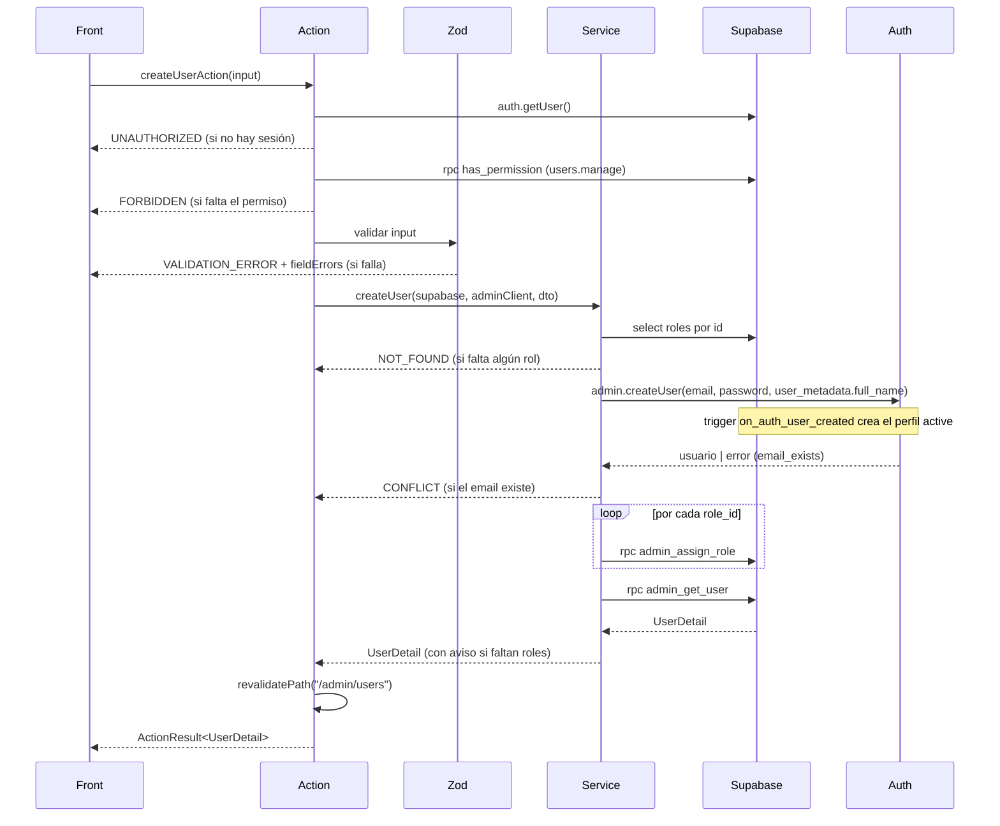

# createUser — Crear usuario

| Campo           | Valor                                                                 |
| --------------- | --------------------------------------------------------------------- |
| Action          | `src/actions/users/createUser.action.ts` (exporta `createUserAction`) |
| Schema          | `src/core/schemas/users/createUser.schema.ts`                         |
| Servicio        | `src/core/services/users/createUser.service.ts`                       |
| Permiso         | Sesión activa y permiso `users.manage`                                |
| Equivalente API | No aplica                                                             |

Definición funcional: [HU-USR-001](../../historias_de_usuario/users/HU_crear_usuario.md). Decisiones: D14 y D15.

## Uso desde el front

| Import             | Ruta                                     | Para qué                                                                                     |
| ------------------ | ---------------------------------------- | -------------------------------------------------------------------------------------------- |
| `createUserAction` | `src/actions/users/createUser.action.ts` | Se llama desde el formulario de alta (`/admin/users/new`)                                    |
| `ActionResult<T>`  | `src/core/types/action-result.ts`        | Tipa la respuesta; se discrimina por `ok` para leer `data` o `error` (`code`, `fieldErrors`) |
| `UserDetail`       | `src/core/types/users/user.types.ts`     | Tipo de `data` en el caso de éxito (`ActionResult<UserDetail>`)                              |
| `CreateUserInput`  | `src/core/types/users/user.types.ts`     | Tipo del input                                                                               |

**Por qué solo esto:** el schema Zod y el Servicio son del back. El formulario puede validar antes de enviar, pero es solo una ayuda de experiencia; la validación real la hace la Action. El `full_name` es obligatorio también en el formulario.

```tsx
const result = await createUserAction(input)

if (!result.ok) {
  // result.error.code, result.error.message, result.error.fieldErrors?
  // CONFLICT: ya existe un usuario con ese email
  return
}

// result.data: UserDetail
// Si pediste roles, comparar result.data.roles con lo pedido: si faltan, result.message lo avisa
```

## Input

| Campo       | Tipo       | Reglas                                                                                        | Requerido |
| ----------- | ---------- | --------------------------------------------------------------------------------------------- | --------- |
| `full_name` | `string`   | Se recorta (`trim`); 2–120 caracteres. Lo escribe quien da el alta; nunca se deduce del email | Sí        |
| `email`     | `string`   | Se recorta y se pasa a minúsculas; formato válido; máximo 254 caracteres; único en Auth       | Sí        |
| `password`  | `string`   | 8–72 caracteres; no se recorta                                                                | Sí        |
| `role_ids`  | `string[]` | UUID válidos; los repetidos se ignoran. Default `[]`                                          | No        |

Campos que **no** se reciben: `status` (siempre `active`), `phone` (se edita después con `updateUser`), `id`, `avatar_path` y fechas. Si llegan, se ignoran.

```json
{
  "full_name": "María Gómez",
  "email": "maria@resto.test",
  "password": "clave-inicial-123",
  "role_ids": ["8a2f4c10-5b9e-4d3a-a6c1-2e7b9d0f1a34"]
}
```

## Éxito

`ActionResult<UserDetail>`

- Devuelve el usuario con `roles` reflejando los roles realmente asignados.
- Si falló la asignación de roles, es éxito con otro `message` (ver Reglas).
- Nunca devuelve la contraseña.

```json
{
  "ok": true,
  "data": {
    "id": "5d1c7e90-3a42-4b8f-9c16-0f2e8a7b6d55",
    "email": "maria@resto.test",
    "full_name": "María Gómez",
    "phone": null,
    "avatar_path": null,
    "status": "active",
    "is_banned": false,
    "created_at": "2026-11-23T14:05:00Z",
    "roles": [
      {
        "id": "8a2f4c10-5b9e-4d3a-a6c1-2e7b9d0f1a34",
        "code": "admin",
        "name": "Administrador",
        "is_active": true
      }
    ]
  },
  "message": "Usuario creado"
}
```

## Errores

| code               | Cuándo                                                                                             | message                              | HTTP (API) |
| ------------------ | -------------------------------------------------------------------------------------------------- | ------------------------------------ | ---------- |
| `VALIDATION_ERROR` | Falla el schema, o Auth rechaza la contraseña por su política (`weak_password`, sin `fieldErrors`) | Datos inválidos                      | 400        |
| `UNAUTHORIZED`     | Sin sesión                                                                                         | Sesión requerida                     | 401        |
| `FORBIDDEN`        | No tiene `users.manage`                                                                            | No tenés permiso para crear usuarios | 403        |
| `NOT_FOUND`        | Algún `role_id` no existe (se comprueba antes de crear la cuenta)                                  | Rol no encontrado                    | 404        |
| `CONFLICT`         | Ya existe un usuario con ese email (`email_exists` de Auth)                                        | Ya existe un usuario con ese email   | 409        |
| `INTERNAL_ERROR`   | Falla inesperada, o falta `SUPABASE_SERVICE_ROLE_KEY`                                              | Error inesperado. Intentá de nuevo   | 500        |

```json
{
  "ok": false,
  "error": {
    "code": "VALIDATION_ERROR",
    "message": "Datos inválidos",
    "fieldErrors": {
      "full_name": ["El nombre completo es obligatorio"]
    }
  }
}
```

## Reglas de negocio aplicadas

- El `full_name` viaja en `user_metadata.full_name` de la cuenta; el trigger `handle_new_auth_user` lo copia a `profiles`. Su respaldo (parte local del email o `Usuario`) no se usa porque el nombre siempre llega.
- La cuenta se crea con `email_confirm: true` y el perfil nace `active`, sin roles.
- **Orden (D15):** sesión → permiso → Zod → comprobar que existen los roles pedidos → `auth.admin.createUser` → `admin_assign_role` por cada rol, con la sesión del actor (la anti-escalada necesita `auth.uid()`).
- **Si la asignación falla** tras crear la cuenta, no se borra nada: el usuario queda sin esos roles y la respuesta es `ok: true` con `message` "Usuario creado, pero no se pudieron asignar los roles. Asignalos desde el detalle". Sin roles no tiene permisos, así que no hay riesgo.
- La contraseña no se guarda, no se devuelve ni se registra.
- **Auditoría:** el alta del perfil queda en `audit_logs` (`insert` en `profiles`), pero con `actor_id` en `NULL` porque la dispara la API de Auth sin `auth.uid()`. Las asignaciones de roles sí registran al actor. Pendiente de decidir (ver HU).
- **Permiso:** la Action comprueba la sesión y `users.manage` con `requirePermission` antes de validar con Zod.

## Validación por capa

- **Action (antes de Zod):** sesión (`UNAUTHORIZED`) y permiso `users.manage` (`FORBIDDEN`).
- **Zod en la Action:** `full_name`, `email`, `password` y `role_ids` según la tabla de Input.
- **Servicio:** existencia de los roles, `createUser` en Auth (traduce `email_exists` a `CONFLICT` y `weak_password` a `VALIDATION_ERROR`), asignación de roles y lectura del usuario creado.
- **Base de datos:** `CHECK` de longitud de `full_name` (2–120) en `profiles`; unicidad del email en Auth; trigger `audit_profiles`.

## Efectos secundarios

- Tras el alta, se llama a `revalidatePath("/admin/users")`.
- Se crea la cuenta en Auth y, por el trigger, el perfil.
- La base registra el alta del perfil y de las asignaciones en `audit_logs`.

## Flujo



## Estado de implementación

- **Implementado:** nada (documentación de la Fase 6). Existen `createAdminClient()` y `getServiceRoleKey()` (F5.2).
- **Pendiente:** schema, Servicio, Action, tipos y el formulario. Las RPC `admin_assign_role` y `admin_get_user` ya están implementadas (F6.2, 2026-11-22).
