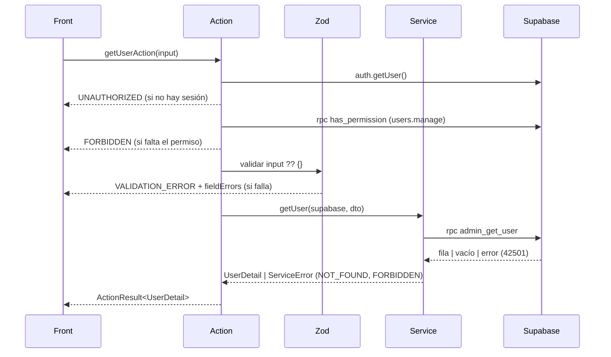

# getUser — Obtener usuario

| Campo           | Valor                                                           |
| --------------- | --------------------------------------------------------------- |
| Action          | `src/actions/users/getUser.action.ts` (exporta `getUserAction`) |
| Schema          | `src/core/schemas/users/getUser.schema.ts`                      |
| Servicio        | `src/core/services/users/getUser.service.ts`                    |
| Permiso         | Sesión activa y permiso `users.manage`                          |
| Equivalente API | No aplica                                                       |

Definición funcional: [HU-USR-003](../../historias_de_usuario/users/HU_obtener_usuario.md). El Servicio llama a la RPC `admin_get_user` (D16).

## Uso desde el front

| Import            | Ruta                                  | Para qué                                                                                     |
| ----------------- | ------------------------------------- | -------------------------------------------------------------------------------------------- |
| `getUserAction`   | `src/actions/users/getUser.action.ts` | Se llama desde la vista de detalle o de edición con el `id` del usuario                      |
| `ActionResult<T>` | `src/core/types/action-result.ts`     | Tipa la respuesta; se discrimina por `ok` para leer `data` o `error` (`code`, `fieldErrors`) |
| `UserDetail`      | `src/core/types/users/user.types.ts`  | Tipo de `data` en el caso de éxito (`ActionResult<UserDetail>`)                              |
| `GetUserInput`    | `src/core/types/users/user.types.ts`  | Tipo del input (`id`)                                                                        |

```tsx
const result = await getUserAction({ id })

if (!result.ok) {
  // result.error.code, result.error.message, result.error.fieldErrors?
  // NOT_FOUND: el usuario no existe
  return
}

// result.data: UserDetail
```

## Input

| Campo | Tipo     | Reglas      | Requerido |
| ----- | -------- | ----------- | --------- |
| `id`  | `string` | UUID válido | Sí        |

```json
{ "id": "5d1c7e90-3a42-4b8f-9c16-0f2e8a7b6d55" }
```

## Éxito

`ActionResult<UserDetail>`

- `roles` incluye los roles inactivos, con `is_active = false`.
- `is_banned` es `true` si la cuenta de Auth está bloqueada.

```json
{
  "ok": true,
  "data": {
    "id": "5d1c7e90-3a42-4b8f-9c16-0f2e8a7b6d55",
    "email": "maria@resto.test",
    "full_name": "María Gómez",
    "phone": "+54 379 4000000",
    "avatar_path": null,
    "status": "active",
    "is_banned": false,
    "created_at": "2026-11-23T14:05:00Z",
    "roles": []
  },
  "message": "Usuario obtenido"
}
```

## Errores

| code               | Cuándo                                                           | message                            | HTTP (API) |
| ------------------ | ---------------------------------------------------------------- | ---------------------------------- | ---------- |
| `VALIDATION_ERROR` | Falla el schema (`id` ausente o no es un UUID)                   | Datos inválidos                    | 400        |
| `UNAUTHORIZED`     | Sin sesión                                                       | Sesión requerida                   | 401        |
| `FORBIDDEN`        | No tiene `users.manage`, o la RPC rechaza por permisos (`42501`) | No tenés permiso para ver usuarios | 403        |
| `NOT_FOUND`        | No existe un usuario con ese `id`                                | Usuario no encontrado              | 404        |
| `INTERNAL_ERROR`   | Falla inesperada                                                 | Error inesperado. Intentá de nuevo | 500        |

```json
{ "ok": false, "error": { "code": "NOT_FOUND", "message": "Usuario no encontrado" } }
```

No usa `CONFLICT`: leer no depende de unicidad.

## Reglas de negocio aplicadas

- Un usuario `inactive` o `pending` se obtiene con normalidad.
- El `id` se valida como UUID en la Action para evitar un error de sintaxis (`22P02`) en la base.
- **Permiso:** la Action comprueba `users.manage` antes de validar; la RPC lo vuelve a exigir.

## Efectos secundarios

Ninguno (lectura pura).

## Flujo



## Estado de implementación

- **Implementado:** nada (documentación de la Fase 6).
- **Implementado (F6.2, 2026-11-22):** RPC `admin_get_user` (devuelve `jsonb` con la forma de `UserDetail`; usuario inexistente: error `P0002`, no fila vacía; `42501` sin permiso).
- **Pendiente:** schema, Servicio, Action, tipos y la pantalla de detalle.
