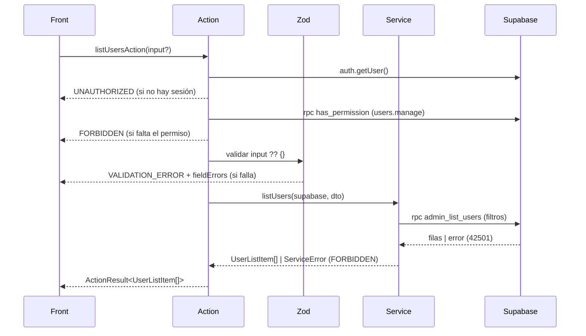

# listUsers — Listar usuarios

| Campo           | Valor                                                               |
| --------------- | ------------------------------------------------------------------- |
| Action          | `src/actions/users/listUsers.action.ts` (exporta `listUsersAction`) |
| Schema          | `src/core/schemas/users/listUsers.schema.ts`                        |
| Servicio        | `src/core/services/users/listUsers.service.ts`                      |
| Permiso         | Sesión activa y permiso `users.manage`                              |
| Equivalente API | No aplica                                                           |

Definición funcional: [HU-USR-002](../../historias_de_usuario/users/HU_listar_usuarios.md). El Servicio llama a la RPC `admin_list_users` (D16): el email vive en `auth.users` y no se lee directo desde la Data API.

## Uso desde el front

| Import            | Ruta                                    | Para qué                                                                                     |
| ----------------- | --------------------------------------- | -------------------------------------------------------------------------------------------- |
| `listUsersAction` | `src/actions/users/listUsers.action.ts` | Se llama desde la pantalla `/admin/users`, con o sin filtros                                 |
| `ActionResult<T>` | `src/core/types/action-result.ts`       | Tipa la respuesta; se discrimina por `ok` para leer `data` o `error` (`code`, `fieldErrors`) |
| `UserListItem`    | `src/core/types/users/user.types.ts`    | Tipo de cada elemento de `data` (`ActionResult<UserListItem[]>`)                             |
| `ListUsersInput`  | `src/core/types/users/user.types.ts`    | Tipo del input (`search`, `status`, `role_id`)                                               |

**Por qué `UserListItem` y no `UserDetail`:** el listado devuelve solo lo que necesita la tabla; `avatar_path` y `created_at` están en el detalle.

```tsx
const result = await listUsersAction({ search, status, role_id })

if (!result.ok) {
  // result.error.code, result.error.message, result.error.fieldErrors?
  return
}

// result.data: UserListItem[]  ([] si no hay resultados, no es un error)
```

## Input

Todo el input es opcional: `listUsersAction()` sin argumentos lista todos los usuarios.

| Campo     | Tipo     | Reglas                                                                                                                                      | Requerido |
| --------- | -------- | ------------------------------------------------------------------------------------------------------------------------------------------- | --------- |
| `search`  | `string` | Se recorta; máximo 80 caracteres; vacío = sin filtro. Coincidencia parcial en `full_name` o `email`, sin distinguir mayúsculas (sí acentos) | No        |
| `status`  | `string` | `pending`, `active` o `inactive`. Si se omite, devuelve todos                                                                               | No        |
| `role_id` | `string` | UUID válido. Solo usuarios que tienen ese rol (aunque esté inactivo)                                                                        | No        |

Sin paginación por ahora. Si hiciera falta, `data` pasa a `{ items, total, page, page_size }` (cambio de contrato).

```json
{ "search": "mar", "status": "active", "role_id": "8a2f4c10-5b9e-4d3a-a6c1-2e7b9d0f1a34" }
```

## Éxito

`ActionResult<UserListItem[]>`

- Orden fijo: `full_name` ascendente y, a igual nombre, `email` ascendente.
- Sin resultados no es un error: `data` es `[]`.

```json
{
  "ok": true,
  "data": [
    {
      "id": "5d1c7e90-3a42-4b8f-9c16-0f2e8a7b6d55",
      "email": "maria@resto.test",
      "full_name": "María Gómez",
      "phone": null,
      "status": "active",
      "is_banned": false,
      "roles": [
        {
          "id": "8a2f4c10-5b9e-4d3a-a6c1-2e7b9d0f1a34",
          "code": "admin",
          "name": "Administrador",
          "is_active": true
        }
      ]
    }
  ],
  "message": "Usuarios obtenidos"
}
```

## Errores

| code               | Cuándo                                                                       | message                            | HTTP (API) |
| ------------------ | ---------------------------------------------------------------------------- | ---------------------------------- | ---------- |
| `VALIDATION_ERROR` | Falla el schema (`search` largo, `status` fuera del enum, `role_id` no UUID) | Datos inválidos                    | 400        |
| `UNAUTHORIZED`     | Sin sesión                                                                   | Sesión requerida                   | 401        |
| `FORBIDDEN`        | No tiene `users.manage`, o la RPC rechaza por permisos (`42501`)             | No tenés permiso para ver usuarios | 403        |
| `INTERNAL_ERROR`   | Falla inesperada                                                             | Error inesperado. Intentá de nuevo | 500        |

```json
{
  "ok": false,
  "error": {
    "code": "VALIDATION_ERROR",
    "message": "Datos inválidos",
    "fieldErrors": { "role_id": ["El id del rol debe ser un UUID válido"] }
  }
}
```

No usa `NOT_FOUND` ni `CONFLICT`: listar nunca falla por ausencia de datos ni por unicidad.

## Reglas de negocio aplicadas

- `%`, `_` y `\` de `search` se tratan como texto literal (la RPC los escapa).
- `is_banned` indica si la cuenta de Auth está bloqueada (`banned_until` en el futuro).
- `roles` incluye los inactivos, con `is_active = false`.
- **Permiso:** la Action comprueba `users.manage` antes de validar; la RPC lo vuelve a exigir.

## Efectos secundarios

Ninguno (lectura pura).

## Flujo



## Estado de implementación

- **Implementado:** nada (documentación de la Fase 6).
- **Implementado (F6.2, 2026-11-22):** RPC `admin_list_users` (devuelve un arreglo `jsonb` con la forma de `UserListItem`; `42501` sin permiso).
- **Pendiente:** schema, Servicio, Action, tipos y la pantalla `/admin/users`.
