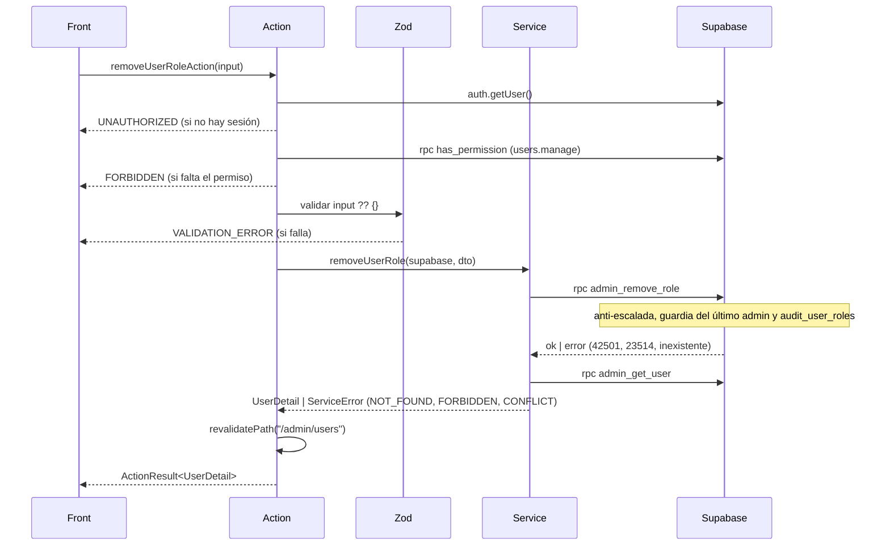

# removeUserRole — Quitar un rol a un usuario

| Campo           | Valor                                                                                           |
| --------------- | ----------------------------------------------------------------------------------------------- |
| Action          | `src/actions/users/removeUserRole.action.ts` (exporta `removeUserRoleAction`)                   |
| Schema          | `src/core/schemas/users/userRole.schema.ts` (`userRoleSchema`, compartido con `assignUserRole`) |
| Servicio        | `src/core/services/users/removeUserRole.service.ts`                                             |
| Permiso         | Sesión activa y permiso `users.manage`                                                          |
| Equivalente API | No aplica                                                                                       |

Definición funcional: [HU-USR-006](../../historias_de_usuario/users/HU_asignar_roles_usuario.md). El Servicio llama a la RPC `admin_remove_role` (D13).

## Uso desde el front

| Import                 | Ruta                                         | Para qué                                                                                     |
| ---------------------- | -------------------------------------------- | -------------------------------------------------------------------------------------------- |
| `removeUserRoleAction` | `src/actions/users/removeUserRole.action.ts` | Se llama desde la pantalla de roles del usuario con el `user_id` y el `role_id`              |
| `ActionResult<T>`      | `src/core/types/action-result.ts`            | Tipa la respuesta; se discrimina por `ok` para leer `data` o `error` (`code`, `fieldErrors`) |
| `UserDetail`           | `src/core/types/users/user.types.ts`         | Tipo de `data` en el caso de éxito (`ActionResult<UserDetail>`)                              |
| `UserRoleInput`        | `src/core/types/users/user.types.ts`         | Tipo del input (`user_id`, `role_id`)                                                        |

```tsx
const result = await removeUserRoleAction({ user_id, role_id })

if (!result.ok) {
  // FORBIDDEN: no tiene users.manage, o intenta cambiar sus propios roles
  // CONFLICT: es el último administrador
  return
}

// result.data: UserDetail (con roles actualizados)
```

## Input

| Campo     | Tipo     | Reglas      | Requerido |
| --------- | -------- | ----------- | --------- |
| `user_id` | `string` | UUID válido | Sí        |
| `role_id` | `string` | UUID válido | Sí        |

```json
{
  "user_id": "5d1c7e90-3a42-4b8f-9c16-0f2e8a7b6d55",
  "role_id": "8a2f4c10-5b9e-4d3a-a6c1-2e7b9d0f1a34"
}
```

## Éxito

`ActionResult<UserDetail>`

```json
{
  "ok": true,
  "data": {
    "id": "5d1c7e90-3a42-4b8f-9c16-0f2e8a7b6d55",
    "email": "maria@resto.test",
    "full_name": "María Gómez",
    "phone": null,
    "avatar_path": null,
    "status": "active",
    "is_banned": false,
    "created_at": "2026-11-23T14:05:00Z",
    "roles": []
  },
  "message": "Rol quitado"
}
```

## Errores

| code               | Cuándo                                                                                      | message                                                                   | HTTP (API) |
| ------------------ | ------------------------------------------------------------------------------------------- | ------------------------------------------------------------------------- | ---------- |
| `VALIDATION_ERROR` | Falla el schema (`user_id` o `role_id` ausentes o no UUID)                                  | Datos inválidos                                                           | 400        |
| `UNAUTHORIZED`     | Sin sesión                                                                                  | Sesión requerida                                                          | 401        |
| `FORBIDDEN`        | No tiene `users.manage`, o intenta quitarse un rol a sí mismo (`42501` de la anti-escalada) | No tenés permiso para quitar roles / No podés modificar tus propios roles | 403        |
| `NOT_FOUND`        | El usuario o el rol no existen                                                              | Usuario no encontrado / Rol no encontrado                                 | 404        |
| `CONFLICT`         | Se quita el rol al último administrador (`23514` de la guardia)                             | No se puede quitar el rol al último administrador                         | 409        |
| `INTERNAL_ERROR`   | Falla inesperada                                                                            | Error inesperado. Intentá de nuevo                                        | 500        |

```json
{
  "ok": false,
  "error": { "code": "CONFLICT", "message": "No se puede quitar el rol al último administrador" }
}
```

## Reglas de negocio aplicadas

- **Idempotente:** quitar un rol que el usuario no tiene responde con éxito y no cambia nada.
- **Último administrador (F5.5):** el trigger `user_roles_protect_last_admin` rechaza con `23514` quitar el rol que da `admin.access` al último administrador; vale para todos.
- **Anti-escalada (F5.4):** nadie se quita roles a sí mismo (`42501`). Se distingue del permiso faltante por el texto del error, igual que en `assignUserRole`.
- **Límite conocido de F5.5:** no cubre borrar `admin.access` de `role_permissions` ni desactivar un rol no sistema que lo tenga; eso se resuelve en las RPC de roles (F6.2).
- **Permiso:** la Action comprueba `users.manage` antes de validar; la RPC y el trigger lo vuelven a exigir.

## Validación por capa

- **Action (antes de Zod):** sesión (`UNAUTHORIZED`) y permiso `users.manage` (`FORBIDDEN`).
- **Zod en la Action:** `user_id` y `role_id` como UUID.
- **Servicio:** RPC, traducción de `42501`, `23514` y recursos inexistentes, y lectura del usuario actualizado.
- **Base de datos:** triggers `user_roles_protect_assignments`, `user_roles_protect_last_admin` y `audit_user_roles`.

## Efectos secundarios

- Tras el cambio, se llama a `revalidatePath("/admin/users")`.
- La base registra la baja de la asignación en `audit_logs` (evento `delete`, con `record_id` `"user_id:role_id"` y el actor) mediante el trigger `audit_user_roles`.

## Flujo



## Estado de implementación

- **Implementado:** los triggers de protección (F5.4 y F5.5) y de auditoría (F4).
- **Implementado (F6.2, 2026-11-22):** RPC `admin_remove_role` (idempotente; usuario o rol inexistente: `P0002`; propio rol: `42501`; último administrador: `23514`).
- **Pendiente:** schema, Servicio, Action, tipos y la pantalla.
