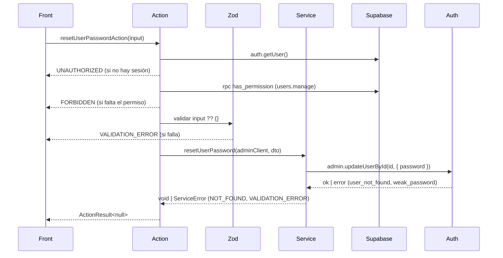

# resetUserPassword — Restablecer la contraseña de un usuario

| Campo           | Valor                                                                               |
| --------------- | ----------------------------------------------------------------------------------- |
| Action          | `src/actions/users/resetUserPassword.action.ts` (exporta `resetUserPasswordAction`) |
| Schema          | `src/core/schemas/users/resetUserPassword.schema.ts`                                |
| Servicio        | `src/core/services/users/resetUserPassword.service.ts`                              |
| Permiso         | Sesión activa y permiso `users.manage`                                              |
| Equivalente API | No aplica                                                                           |

Definición funcional: [HU-USR-007](../../historias_de_usuario/users/HU_restablecer_contrasena_usuario.md). No usa RPC: no toca tablas propias; llama a `auth.admin.updateUserById` con `createAdminClient()`.

## Uso desde el front

| Import                    | Ruta                                            | Para qué                                                                                     |
| ------------------------- | ----------------------------------------------- | -------------------------------------------------------------------------------------------- |
| `resetUserPasswordAction` | `src/actions/users/resetUserPassword.action.ts` | Se llama desde el formulario "Restablecer contraseña" del detalle del usuario                |
| `ActionResult<T>`         | `src/core/types/action-result.ts`               | Tipa la respuesta; se discrimina por `ok` para leer `data` o `error` (`code`, `fieldErrors`) |
| `ResetUserPasswordInput`  | `src/core/types/users/user.types.ts`            | Tipo del input (`id`, `password`)                                                            |

```tsx
const result = await resetUserPasswordAction({ id, password })

if (!result.ok) {
  // result.error.code, result.error.message, result.error.fieldErrors?
  return
}

// result.data: null
```

## Input

| Campo      | Tipo     | Reglas                         | Requerido |
| ---------- | -------- | ------------------------------ | --------- |
| `id`       | `string` | UUID válido                    | Sí        |
| `password` | `string` | 8–72 caracteres; no se recorta | Sí        |

```json
{ "id": "5d1c7e90-3a42-4b8f-9c16-0f2e8a7b6d55", "password": "clave-nueva-456" }
```

## Éxito

`ActionResult<null>`

```json
{ "ok": true, "data": null, "message": "Contraseña restablecida" }
```

## Errores

| code               | Cuándo                                                                                             | message                                       | HTTP (API) |
| ------------------ | -------------------------------------------------------------------------------------------------- | --------------------------------------------- | ---------- |
| `VALIDATION_ERROR` | Falla el schema, o Auth rechaza la contraseña por su política (`weak_password`, sin `fieldErrors`) | Datos inválidos                               | 400        |
| `UNAUTHORIZED`     | Sin sesión                                                                                         | Sesión requerida                              | 401        |
| `FORBIDDEN`        | No tiene `users.manage`                                                                            | No tenés permiso para restablecer contraseñas | 403        |
| `NOT_FOUND`        | No existe un usuario con ese `id` (`user_not_found` de Auth)                                       | Usuario no encontrado                         | 404        |
| `INTERNAL_ERROR`   | Falla inesperada, o falta `SUPABASE_SERVICE_ROLE_KEY`                                              | Error inesperado. Intentá de nuevo            | 500        |

```json
{ "ok": false, "error": { "code": "NOT_FOUND", "message": "Usuario no encontrado" } }
```

No usa `CONFLICT`.

## Reglas de negocio aplicadas

- La contraseña no se guarda, no se devuelve ni se registra (tampoco en `console.error`).
- Se puede aplicar a un usuario en cualquier estado y a la propia cuenta; si el usuario está `inactive`, sigue bloqueado.
- No se cierran las sesiones que el usuario ya tenía abiertas (a evaluar).
- **Auditoría:** no deja registro en `audit_logs` (`auth.users` no está auditada y no se toca ninguna tabla propia). Pendiente de decidir un registro propio.
- **Permiso:** la Action comprueba la sesión y `users.manage` con `requirePermission` antes de validar. No hay RLS que lo refuerce porque la operación usa la API de administración de Auth (`service_role`): en esta operación la Action es la única barrera.

## Validación por capa

- **Action (antes de Zod):** sesión (`UNAUTHORIZED`) y permiso `users.manage` (`FORBIDDEN`).
- **Zod en la Action:** UUID del `id` y longitud de la contraseña.
- **Servicio:** `auth.admin.updateUserById`, traducción de `user_not_found` y `weak_password`.
- **Base de datos:** no interviene.

## Efectos secundarios

- Se reemplaza la contraseña en Auth. No hay `revalidatePath`: ninguna vista depende de la contraseña.

## Flujo



## Estado de implementación

- **Implementado:** nada (documentación de la Fase 6). Existe `createAdminClient()` (F5.2).
- **Pendiente:** schema, Servicio, Action, tipo del input y el formulario.
