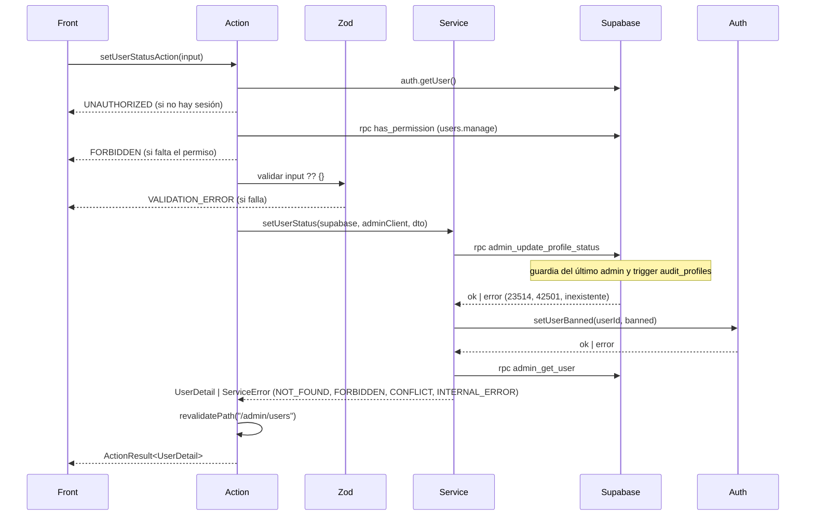

# setUserStatus — Cambiar el estado de un usuario

| Campo           | Valor                                                                       |
| --------------- | --------------------------------------------------------------------------- |
| Action          | `src/actions/users/setUserStatus.action.ts` (exporta `setUserStatusAction`) |
| Schema          | `src/core/schemas/users/setUserStatus.schema.ts`                            |
| Servicio        | `src/core/services/users/setUserStatus.service.ts`                          |
| Permiso         | Sesión activa y permiso `users.manage`                                      |
| Equivalente API | No aplica                                                                   |

Definición funcional: [HU-USR-005](../../historias_de_usuario/users/HU_cambiar_estado_usuario.md). El Servicio llama a la RPC `admin_update_profile_status` (D13) y después a `setUserBanned` (F5.2).

## Uso desde el front

| Import                | Ruta                                        | Para qué                                                                                     |
| --------------------- | ------------------------------------------- | -------------------------------------------------------------------------------------------- |
| `setUserStatusAction` | `src/actions/users/setUserStatus.action.ts` | Se llama desde los botones "Inactivar" y "Reactivar" con el `id` y el estado nuevo           |
| `ActionResult<T>`     | `src/core/types/action-result.ts`           | Tipa la respuesta; se discrimina por `ok` para leer `data` o `error` (`code`, `fieldErrors`) |
| `UserDetail`          | `src/core/types/users/user.types.ts`        | Tipo de `data` en el caso de éxito (`ActionResult<UserDetail>`)                              |
| `SetUserStatusInput`  | `src/core/types/users/user.types.ts`        | Tipo del input (`id`, `status`)                                                              |

```tsx
const result = await setUserStatusAction({ id, status: "inactive" })

if (!result.ok) {
  // CONFLICT: es el último administrador
  // INTERNAL_ERROR: el estado puede haber cambiado pero Auth no se actualizó; reintentar la misma operación
  return
}

// result.data: UserDetail (status e is_banned actualizados)
```

## Input

| Campo    | Tipo     | Reglas                                             | Requerido |
| -------- | -------- | -------------------------------------------------- | --------- |
| `id`     | `string` | UUID válido                                        | Sí        |
| `status` | `string` | `active` o `inactive`. `pending` no se puede fijar | Sí        |

```json
{ "id": "5d1c7e90-3a42-4b8f-9c16-0f2e8a7b6d55", "status": "inactive" }
```

## Éxito

`ActionResult<UserDetail>`

```json
{
  "ok": true,
  "data": {
    "id": "5d1c7e90-3a42-4b8f-9c16-0f2e8a7b6d55",
    "email": "maria@resto.test",
    "full_name": "María Gómez",
    "phone": null,
    "avatar_path": null,
    "status": "inactive",
    "is_banned": true,
    "created_at": "2026-11-23T14:05:00Z",
    "roles": []
  },
  "message": "Estado actualizado"
}
```

## Errores

| code               | Cuándo                                                                           | message                                             | HTTP (API) |
| ------------------ | -------------------------------------------------------------------------------- | --------------------------------------------------- | ---------- |
| `VALIDATION_ERROR` | Falla el schema (`id` inválido, `status` ausente o fuera de `active`/`inactive`) | Datos inválidos                                     | 400        |
| `UNAUTHORIZED`     | Sin sesión                                                                       | Sesión requerida                                    | 401        |
| `FORBIDDEN`        | No tiene `users.manage`, o la RPC rechaza por permisos (`42501`)                 | No tenés permiso para cambiar el estado de usuarios | 403        |
| `NOT_FOUND`        | No existe un usuario con ese `id`                                                | Usuario no encontrado                               | 404        |
| `CONFLICT`         | Se intenta inactivar al último administrador (`23514` de la guardia)             | No se puede inactivar al último administrador       | 409        |
| `INTERNAL_ERROR`   | Falla inesperada, o falla el bloqueo/desbloqueo en Auth tras cambiar el estado   | Error inesperado. Intentá de nuevo                  | 500        |

```json
{
  "ok": false,
  "error": { "code": "CONFLICT", "message": "No se puede inactivar al último administrador" }
}
```

## Reglas de negocio aplicadas

- **Orden obligatorio:** primero la RPC cambia `profiles.status`; recién después `setUserBanned` bloquea o desbloquea la cuenta. Así la guardia del último administrador rechaza antes de bloquear a alguien.
- **Si falla Auth:** el estado de la base ya cambió y la respuesta es `INTERNAL_ERROR`. Es seguro: un perfil `inactive` no lee datos (las políticas exigen `active`) aunque el token siga vigente; y uno `active` con cuenta bloqueada solo pierde el acceso. Repetir la operación corrige la diferencia.
- **Idempotente:** si el usuario ya tiene ese estado, responde con éxito y vuelve a aplicar el bloqueo o el desbloqueo.
- `pending` no se puede fijar; un usuario `pending` sí se puede pasar a `active` o `inactive`.
- `is_banned` del resultado se calcula después de aplicar el cambio en Auth.
- **Pendiente de decidir:** si un administrador puede inactivarse a sí mismo (hoy solo lo frena la guardia del último administrador) y si hay que cerrar las sesiones abiertas.
- **Permiso:** la Action comprueba `users.manage` antes de validar; la RPC lo vuelve a exigir.

## Validación por capa

- **Action (antes de Zod):** sesión (`UNAUTHORIZED`) y permiso `users.manage` (`FORBIDDEN`).
- **Zod en la Action:** UUID del `id` y `status` en `active`/`inactive`.
- **Servicio:** RPC, traducción de `42501`, `23514` y usuario inexistente; después `setUserBanned` (`NOT_FOUND` o `INTERNAL_ERROR`) y lectura del usuario.
- **Base de datos:** enum `profile_status`, guardia `profiles_protect_last_admin` y el trigger `audit_profiles`.

## Efectos secundarios

- Tras el cambio, se llama a `revalidatePath("/admin/users")`.
- Se bloquea o desbloquea la cuenta en Auth (`banned_until`).
- La base registra el cambio en `audit_logs` (evento `update`, con el actor) mediante el trigger `audit_profiles`.

## Flujo



## Estado de implementación

- **Implementado:** `setUserBanned` (F5.2) y la guardia del último administrador (F5.5).
- **Pendiente:** RPC `admin_update_profile_status`, schema, Servicio, Action, tipos y los botones en `/admin/users`. Mapear `user_banned` en `login.service` (F5.9).
