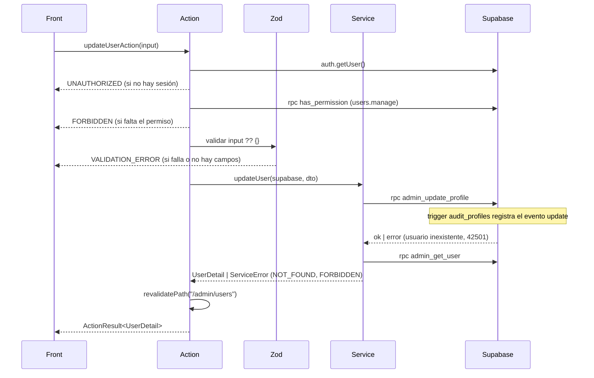

# updateUser — Modificar datos de un usuario

| Campo           | Valor                                                                 |
| --------------- | --------------------------------------------------------------------- |
| Action          | `src/actions/users/updateUser.action.ts` (exporta `updateUserAction`) |
| Schema          | `src/core/schemas/users/updateUser.schema.ts`                         |
| Servicio        | `src/core/services/users/updateUser.service.ts`                       |
| Permiso         | Sesión activa y permiso `users.manage`                                |
| Equivalente API | No aplica                                                             |

Definición funcional: [HU-USR-004](../../historias_de_usuario/users/HU_actualizar_usuario.md). El Servicio llama a la RPC `admin_update_profile` (D16), porque `profiles` no tiene `UPDATE` directo.

## Uso desde el front

| Import             | Ruta                                     | Para qué                                                                                     |
| ------------------ | ---------------------------------------- | -------------------------------------------------------------------------------------------- |
| `updateUserAction` | `src/actions/users/updateUser.action.ts` | Se llama desde el formulario de edición con el `id` y los campos que cambiaron               |
| `ActionResult<T>`  | `src/core/types/action-result.ts`        | Tipa la respuesta; se discrimina por `ok` para leer `data` o `error` (`code`, `fieldErrors`) |
| `UserDetail`       | `src/core/types/users/user.types.ts`     | Tipo de `data` en el caso de éxito (`ActionResult<UserDetail>`)                              |
| `UpdateUserInput`  | `src/core/types/users/user.types.ts`     | Tipo del input (`id` y los campos a modificar)                                               |

**Por qué es una actualización parcial:** el formulario envía solo lo que cambió. Un campo omitido no se modifica. Para quitar el teléfono se envía `phone: null`; omitirlo lo deja como está.

```tsx
const result = await updateUserAction({ id, full_name })

if (!result.ok) {
  // result.error.code, result.error.message, result.error.fieldErrors?
  // NOT_FOUND: el usuario no existe
  return
}

// result.data: UserDetail
```

## Input

| Campo       | Tipo             | Reglas                                                            | Requerido |
| ----------- | ---------------- | ----------------------------------------------------------------- | --------- |
| `id`        | `string`         | UUID válido                                                       | Sí        |
| `full_name` | `string`         | Se recorta; 2–120 caracteres                                      | No        |
| `phone`     | `string \| null` | Se recorta; 1–30 caracteres si se envía; `null` quita el teléfono | No        |

**Regla del conjunto:** además de `id`, hay que enviar al menos un campo a modificar. Un input con solo `id` es `VALIDATION_ERROR`.

Campos que **no** se reciben: `email`, `status`, `roles`, `avatar_path`, `created_at` y `updated_at`. Si llegan, se ignoran.

```json
{ "id": "5d1c7e90-3a42-4b8f-9c16-0f2e8a7b6d55", "full_name": "María G. Gómez", "phone": null }
```

## Éxito

`ActionResult<UserDetail>`

- Devuelve el usuario ya modificado, con los mismos campos que `getUser`.

```json
{
  "ok": true,
  "data": {
    "id": "5d1c7e90-3a42-4b8f-9c16-0f2e8a7b6d55",
    "email": "maria@resto.test",
    "full_name": "María G. Gómez",
    "phone": null,
    "avatar_path": null,
    "status": "active",
    "is_banned": false,
    "created_at": "2026-11-23T14:05:00Z",
    "roles": []
  },
  "message": "Usuario actualizado"
}
```

## Errores

| code               | Cuándo                                                           | message                                   | HTTP (API) |
| ------------------ | ---------------------------------------------------------------- | ----------------------------------------- | ---------- |
| `VALIDATION_ERROR` | Falla el schema, o no se envía ningún campo a modificar          | Datos inválidos / Enviá al menos un campo | 400        |
| `UNAUTHORIZED`     | Sin sesión                                                       | Sesión requerida                          | 401        |
| `FORBIDDEN`        | No tiene `users.manage`, o la RPC rechaza por permisos (`42501`) | No tenés permiso para modificar usuarios  | 403        |
| `NOT_FOUND`        | No existe un usuario con ese `id`                                | Usuario no encontrado                     | 404        |
| `INTERNAL_ERROR`   | Falla inesperada                                                 | Error inesperado. Intentá de nuevo        | 500        |

Cuando falla la regla del conjunto, `fieldErrors` queda vacío y `message` trae el motivo (`Enviá al menos un campo para modificar`). No usa `CONFLICT`: ningún campo editable es único.

```json
{ "ok": false, "error": { "code": "NOT_FOUND", "message": "Usuario no encontrado" } }
```

## Reglas de negocio aplicadas

- Se puede modificar a un usuario en cualquier estado y también al propio.
- La RPC debe distinguir un campo omitido de `null` (por ejemplo, con un parámetro que indique si se envió `phone`), para poder quitar el teléfono sin tocarlo cuando se omite.
- `updated_at` lo actualiza el trigger `profiles_set_updated_at` y no se detecta "sin cambios": la fila se actualiza igual.
- Concurrencia: gana la última escritura.
- La base replica los límites con `profiles_full_name_length` y `profiles_phone_length`.
- **Permiso:** la Action comprueba `users.manage` antes de validar; la RPC lo vuelve a exigir.

## Validación por capa

- **Action (antes de Zod):** sesión (`UNAUTHORIZED`) y permiso `users.manage` (`FORBIDDEN`).
- **Zod en la Action:** UUID del `id`, recorte y longitud de `full_name` y `phone`, y al menos un campo.
- **Servicio:** llamada a la RPC, traducción de `42501` y de usuario inexistente (`NOT_FOUND`), y lectura del usuario modificado.
- **Base de datos:** `CHECK` de longitud y el trigger `audit_profiles`.

## Efectos secundarios

- Tras modificar, se llama a `revalidatePath("/admin/users")`.
- La base registra el cambio en `audit_logs` (evento `update`, con `old_data`, `new_data` y el actor) mediante el trigger `audit_profiles`.

## Flujo



## Estado de implementación

- **Implementado:** nada (documentación de la Fase 6).
- **Pendiente:** RPC `admin_update_profile`, schema, Servicio, Action y tipos.
