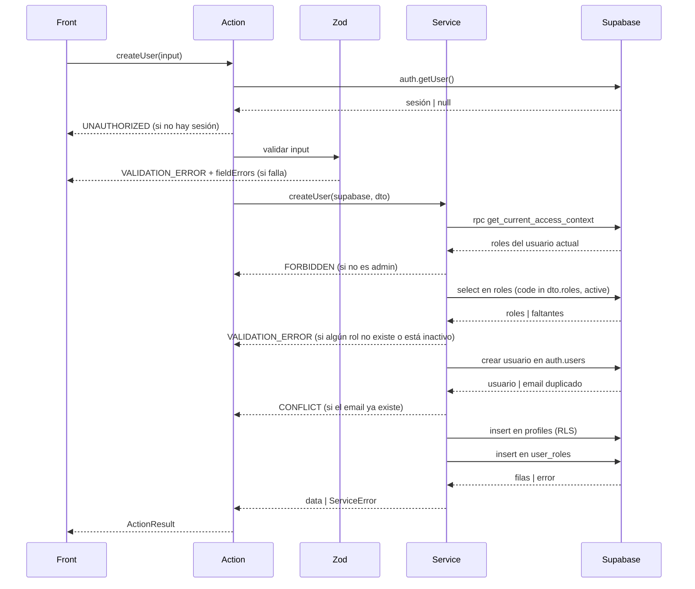

# createUser — Crear usuario

| Campo           | Valor                                           |
| --------------- | ----------------------------------------------- |
| Action          | `src/actions/users/createUser.action.ts`        |
| Schema          | `src/core/schemas/users/createUser.schema.ts`   |
| Servicio        | `src/core/services/users/createUser.service.ts` |
| Permiso         | Sesión activa, rol `admin`                      |
| Equivalente API | `POST /api/users → 201`                         |

## Input

| Campo       | Tipo       | Reglas                                                                                                 | Requerido |
| ----------- | ---------- | ------------------------------------------------------------------------------------------------------ | --------- |
| `email`     | `string`   | Email válido, único en `auth.users`                                                                    | Sí        |
| `full_name` | `string`   | 2–80 caracteres                                                                                        | Sí        |
| `roles`     | `string[]` | 1 o más códigos de `roles.code`, sin repetir. Cada código debe existir y estar activo (`roles.active`) | Sí        |
| `phone`     | `string`   | Formato E.164                                                                                          | No        |
| `notes`     | `string`   | Texto libre, máx. 500 caracteres                                                                       | No        |

No son input: `id` (lo genera `auth.users`), `active` (inicia en `true`), `archived_at` (inicia en `null`).

```json
{
  "email": "ana@empresa.com",
  "full_name": "Ana Pérez",
  "roles": ["cajero"],
  "phone": "+5493794123456",
  "notes": "Turno tarde"
}
```

## Éxito

`ActionResult<User>`

```json
{
  "ok": true,
  "data": {
    "id": "7b1e4c52-9d3a-4f0e-8a21-5c6d7e8f9a01",
    "email": "ana@empresa.com",
    "full_name": "Ana Pérez",
    "phone": "+5493794123456",
    "notes": "Turno tarde",
    "roles": ["cajero"],
    "active": true,
    "archived_at": null,
    "created_at": "2026-11-09T17:26:00Z",
    "updated_at": "2026-11-09T17:26:00Z"
  },
  "message": "Usuario creado"
}
```

## Errores

| code               | Cuándo                                                               | message                              | HTTP (API) |
| ------------------ | -------------------------------------------------------------------- | ------------------------------------ | ---------- |
| `VALIDATION_ERROR` | Falla el schema, o algún código de `roles` no existe o está inactivo | Datos inválidos                      | 400        |
| `UNAUTHORIZED`     | Sin sesión                                                           | Sesión requerida                     | 401        |
| `FORBIDDEN`        | El usuario no tiene el rol `admin`                                   | No tenés permiso para crear usuarios | 403        |
| `CONFLICT`         | El email ya existe en `auth.users`                                   | El email ya está registrado          | 409        |
| `INTERNAL_ERROR`   | Falla inesperada                                                     | Error inesperado. Intentá de nuevo   | 500        |

```json
{
  "ok": false,
  "error": {
    "code": "VALIDATION_ERROR",
    "message": "Datos inválidos",
    "fieldErrors": {
      "email": ["Email inválido"]
    }
  }
}
```

## Efectos secundarios

- Crea el usuario en `auth.users`
- Inserta la fila en `profiles` con `active = true` y `archived_at = null`
- Inserta una fila en `user_roles` por cada código de `roles`, con `assigned_by` = id del admin que ejecuta la Action
- Si falla un paso posterior a la creación en `auth.users`, se elimina ese usuario para no dejar registros huérfanos
- `revalidatePath("/users")`

## Flujo


