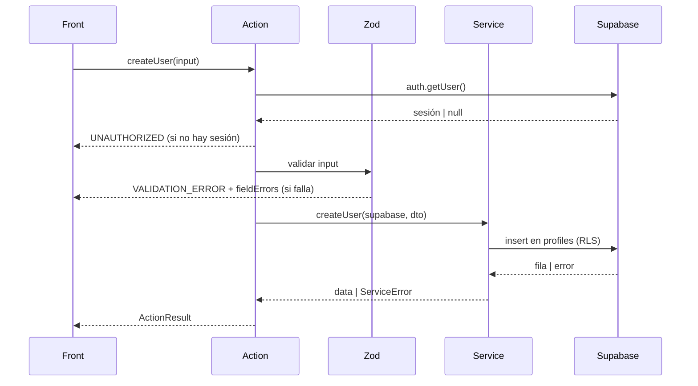

# createUser — Crear usuario

| Campo           | Valor                                           |
| --------------- | ----------------------------------------------- |
| Action          | `src/actions/users/createUser.action.ts`        |
| Schema          | `src/core/schemas/users/createUser.schema.ts`   |
| Servicio        | `src/core/services/users/createUser.service.ts` |
| Permiso         | Sesión activa, rol `admin`                      |
| Equivalente API | `POST /api/users → 201`                         |

## Input

| Campo       | Tipo                             | Reglas              | Requerido |
| ----------- | -------------------------------- | ------------------- | --------- |
| `email`     | `string`                         | Email válido, único | Sí        |
| `full_name` | `string`                         | 2–80 caracteres     | Sí        |
| `role`      | `"admin" \| "staff" \| "client"` |                     | Sí        |
| `phone`     | `string`                         | Formato E.164       | No        |

```json
{
  "email": "ana@empresa.com",
  "full_name": "Ana Pérez",
  "role": "staff",
  "phone": "+5493794123456"
}
```

## Éxito

`ActionResult<User>`

```json
{
  "ok": true,
  "data": {
    "id": "7b1e4c52-9d3a-4f0e-8a21-5c6d7e8f9a01",
    "email": "ana@empresa.com",
    "full_name": "Ana Pérez",
    "role": "staff",
    "phone": "+5493794123456",
    "avatar_url": null,
    "created_at": "2026-11-08T18:30:00Z"
  },
  "message": "Usuario creado"
}
```

## Errores

| code               | Cuándo               | message                              | HTTP (API) |
| ------------------ | -------------------- | ------------------------------------ | ---------- |
| `VALIDATION_ERROR` | Falla el schema      | Datos inválidos                      | 400        |
| `UNAUTHORIZED`     | Sin sesión           | Sesión requerida                     | 401        |
| `FORBIDDEN`        | El rol no es `admin` | No tenés permiso para crear usuarios | 403        |
| `CONFLICT`         | El email ya existe   | El email ya está registrado          | 409        |
| `INTERNAL_ERROR`   | Falla inesperada     | Error inesperado. Intentá de nuevo   | 500        |

```json
{
  "ok": false,
  "error": {
    "code": "VALIDATION_ERROR",
    "message": "Datos inválidos",
    "fieldErrors": {
      "email": ["Email inválido"]
    }
  }
}
```

## Efectos secundarios

- `revalidatePath("/users")`

## Flujo


