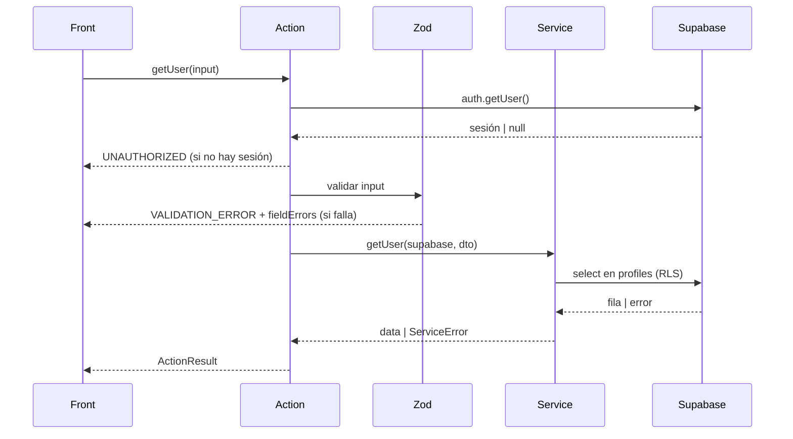

# getUser — Obtener usuario

| Campo | Valor |
|---|---|
| Action | `src/actions/users/getUser.action.ts` |
| Schema | `src/core/schemas/users/getUser.schema.ts` |
| Servicio | `src/core/services/users/getUser.service.ts` |
| Permiso | Sesión activa. `admin` ve cualquiera; el resto solo su propio perfil (RLS) |
| Equivalente API | `GET /api/users/{id} → 200` |

## Input

| Campo | Tipo | Reglas | Requerido |
|---|---|---|---|
| `id` | `uuid` | UUID válido | Sí |

```json
{
  "id": "7b1e4c52-9d3a-4f0e-8a21-5c6d7e8f9a01"
}
```

## Éxito

`ActionResult<User>`

```json
{
  "ok": true,
  "data": {
    "id": "7b1e4c52-9d3a-4f0e-8a21-5c6d7e8f9a01",
    "email": "ana@empresa.com",
    "full_name": "Ana Pérez",
    "role": "staff",
    "phone": "+5493794123456",
    "avatar_url": null,
    "created_at": "2026-11-08T18:30:00Z"
  },
  "message": "Usuario obtenido"
}
```

## Errores

| code | Cuándo | message | HTTP (API) |
|---|---|---|---|
| `VALIDATION_ERROR` | `id` no es un UUID | Datos inválidos | 400 |
| `UNAUTHORIZED` | Sin sesión | Sesión requerida | 401 |
| `NOT_FOUND` | No existe o RLS lo oculta | Usuario no encontrado | 404 |
| `INTERNAL_ERROR` | Falla inesperada | Error inesperado. Intentá de nuevo | 500 |

```json
{
  "ok": false,
  "error": {
    "code": "VALIDATION_ERROR",
    "message": "Datos inválidos",
    "fieldErrors": {
      "id": [
        "UUID inválido"
      ]
    }
  }
}
```

## Efectos secundarios

- Ninguno

## Flujo


