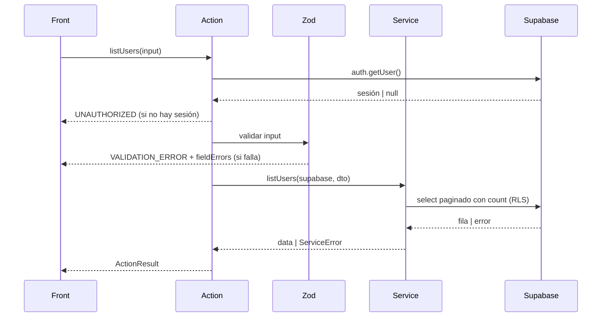

# listUsers — Listar usuarios

| Campo           | Valor                                                |
| --------------- | ---------------------------------------------------- |
| Action          | `src/actions/users/listUsers.action.ts`              |
| Schema          | `src/core/schemas/users/listUsers.schema.ts`         |
| Servicio        | `src/core/services/users/listUsers.service.ts`       |
| Permiso         | Sesión activa, rol `admin`                           |
| Equivalente API | `GET /api/users?page=&pageSize=&search=&role= → 200` |

## Input

| Campo      | Tipo                             | Reglas                                             | Requerido |
| ---------- | -------------------------------- | -------------------------------------------------- | --------- |
| `page`     | `number`                         | Entero ≥ 1. Por defecto 1                          | No        |
| `pageSize` | `number`                         | Entero 1–100. Por defecto 20                       | No        |
| `search`   | `string`                         | Máx. 80 caracteres. Busca en `full_name` y `email` | No        |
| `role`     | `"admin" \| "staff" \| "client"` | Filtro por rol                                     | No        |

```json
{
  "page": 1,
  "pageSize": 20,
  "search": "ana",
  "role": "staff"
}
```

## Éxito

`ActionResult<{ items: User[]; total: number; page: number; pageSize: number }>`

```json
{
  "ok": true,
  "data": {
    "items": [
      {
        "id": "7b1e4c52-9d3a-4f0e-8a21-5c6d7e8f9a01",
        "email": "ana@empresa.com",
        "full_name": "Ana Pérez",
        "role": "staff",
        "phone": "+5493794123456",
        "avatar_url": null,
        "created_at": "2026-11-08T18:30:00Z"
      }
    ],
    "total": 42,
    "page": 1,
    "pageSize": 20
  },
  "message": "Usuarios obtenidos"
}
```

## Errores

| code               | Cuándo               | message                               | HTTP (API) |
| ------------------ | -------------------- | ------------------------------------- | ---------- |
| `VALIDATION_ERROR` | Falla el schema      | Datos inválidos                       | 400        |
| `UNAUTHORIZED`     | Sin sesión           | Sesión requerida                      | 401        |
| `FORBIDDEN`        | El rol no es `admin` | No tenés permiso para listar usuarios | 403        |
| `INTERNAL_ERROR`   | Falla inesperada     | Error inesperado. Intentá de nuevo    | 500        |

```json
{
  "ok": false,
  "error": {
    "code": "VALIDATION_ERROR",
    "message": "Datos inválidos",
    "fieldErrors": {
      "pageSize": ["Debe ser un entero entre 1 y 100"]
    }
  }
}
```

## Efectos secundarios

- Ninguno

## Flujo


