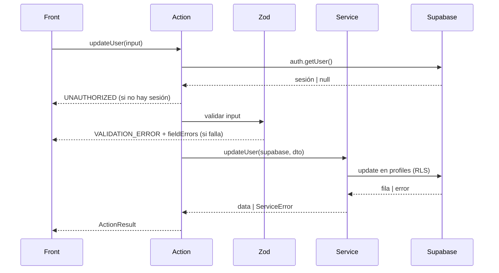

# updateUser — Actualizar usuario

| Campo           | Valor                                                                                 |
| --------------- | ------------------------------------------------------------------------------------- |
| Action          | `src/actions/users/updateUser.action.ts`                                              |
| Schema          | `src/core/schemas/users/updateUser.schema.ts`                                         |
| Servicio        | `src/core/services/users/updateUser.service.ts`                                       |
| Permiso         | Sesión activa. `admin` edita cualquiera; el resto solo su perfil y sin cambiar `role` |
| Equivalente API | `PATCH /api/users/{id} → 200`                                                         |

## Input

| Campo       | Tipo                             | Reglas                         | Requerido |
| ----------- | -------------------------------- | ------------------------------ | --------- |
| `id`        | `uuid`                           | UUID válido                    | Sí        |
| `full_name` | `string`                         | 2–80 caracteres                | No        |
| `role`      | `"admin" \| "staff" \| "client"` | Solo `admin` puede cambiarlo   | No        |
| `phone`     | `string \| null`                 | Formato E.164; `null` lo borra | No        |

```json
{
  "id": "7b1e4c52-9d3a-4f0e-8a21-5c6d7e8f9a01",
  "full_name": "Ana P. Gómez",
  "phone": null
}
```

## Éxito

`ActionResult<User>`

```json
{
  "ok": true,
  "data": {
    "id": "7b1e4c52-9d3a-4f0e-8a21-5c6d7e8f9a01",
    "email": "ana@empresa.com",
    "full_name": "Ana P. Gómez",
    "role": "staff",
    "phone": null,
    "avatar_url": null,
    "created_at": "2026-11-08T18:30:00Z"
  },
  "message": "Usuario actualizado"
}
```

## Errores

| code               | Cuándo                                                 | message                                   | HTTP (API) |
| ------------------ | ------------------------------------------------------ | ----------------------------------------- | ---------- |
| `VALIDATION_ERROR` | Falla el schema o no viene ningún campo a editar       | Datos inválidos                           | 400        |
| `UNAUTHORIZED`     | Sin sesión                                             | Sesión requerida                          | 401        |
| `FORBIDDEN`        | Edita a otro sin ser `admin`, o intenta cambiar `role` | No tenés permiso para editar este usuario | 403        |
| `NOT_FOUND`        | No existe o RLS lo oculta                              | Usuario no encontrado                     | 404        |
| `INTERNAL_ERROR`   | Falla inesperada                                       | Error inesperado. Intentá de nuevo        | 500        |

```json
{
  "ok": false,
  "error": {
    "code": "VALIDATION_ERROR",
    "message": "Datos inválidos",
    "fieldErrors": {
      "id": ["UUID inválido"]
    }
  }
}
```

## Efectos secundarios

- `revalidatePath("/users")`
- `revalidatePath("/users/[id]")`

> El email no se edita desde esta acción.

## Flujo


